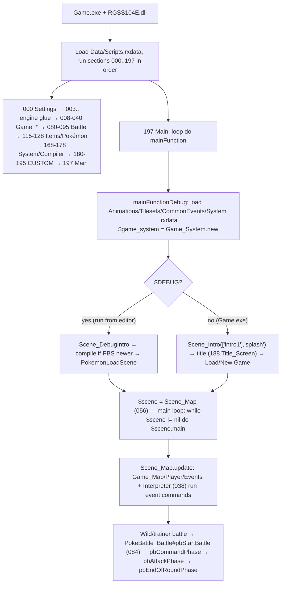
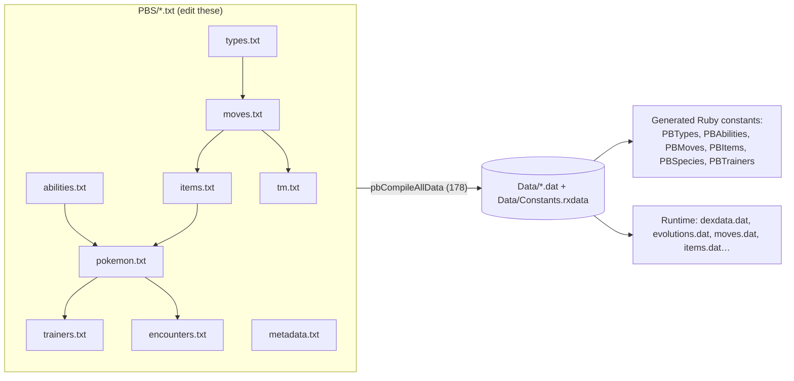

# Pokémon REM — Architecture Guide & Modding Blueprint

> Audit of `Pokemon-REM/` (git: 4 commits, 2026-02-24 → 2026-09-04).
> Method: I extracted all 199 script sections from `Data/Scripts.rxdata` (zlib + Marshal) into plain `.rb` files and read them against the PBS data and the compiler. Script references below use **section names/numbers as they appear in the RPG Maker XP script editor** (e.g. `178 Compiler`). Line numbers refer to the extracted section text.
>
> **Confidence legend:** ✅ read in code · 🔶 inferred from code/data, not run · ❓ not verified (see §9).

---

## 1. Engine & Environment

| Item | Finding |
|---|---|
| Engine | **RPG Maker XP + Pokémon Essentials (v16-era codebase, Spanish translation)** ✅ |
| Runtime | RGSS1 on Ruby 1.8-flavoured syntax. `Game.ini` → `Library=RGSS104E.dll`, `Scripts=Data\Scripts.rxdata`, title "Pokémon REM" ✅ |
| Editor | RPG Maker XP 1.05 (`Game.rxproj` = `RPGXP 1.05`); `Editor.exe`/`Editor.ini` is the Essentials editor shell (uses `Data/EditorScripts.rxdata`) ✅ |
| Platform | Windows-only binaries (`Game.exe`, `Win32API` calls in `Main`). On macOS you can read/diff the data but cannot run it natively 🔶 |
| Why "v16-era" | `PBSpecies/PBMoves/PBItems` constant modules, `isConst?(…)`, `PokeBattle_Move_0XX` function codes, `Data/*.dat` binary DBs, `pbCompileAllData`, no `GameData` module, no real PluginManager. The `ESSENTIALSVERSION` constant is not defined (checked: only `isVersion17?` references it) ✅ |
| Mechanics level | Gen 8-ish content (905 species in `PBS/pokemon.txt`, Galarian forms, Calyrex, Enamorus, Urshifu) on a **Gen 6/7 battle core** (`USENEWBATTLEMECHANICS = true`) ✅ |
| Language | Ruby (game logic) + plain-text PBS (data). UI/dialogue text is **Spanish** (`_INTL("…")`) ✅ |

### 1.1 Where the code actually lives (important)

```
Pokemon-REM/
├── Data/Scripts.rxdata      ← THE game code (199 sections, 839 KB, binary). NOT readable in git diffs.
├── Data/EditorScripts.rxdata← Code for the Essentials editor
├── Data/*.dat               ← COMPILED databases generated from PBS/ (do not hand-edit)
├── Data/MapNNN.rxdata       ← Maps + events (24 maps)   Data/MapInfos.rxdata = map tree/names
├── Data/CommonEvents.rxdata, System.rxdata, Tilesets.rxdata, Animations.rxdata, PkmnAnimations.rxdata
├── PBS/*.txt                ← Human-editable game data (source of truth for Pokémon/moves/items/…)
├── Graphics/ Audio/ Fonts/  ← Assets
├── Plugins/                 ← 2,796 lines of Ruby (Luka S.J. "EBS-style" helper library). See §1.2 ⚠
└── *.exe / *.dll            ← Game.exe, Editor.exe, animmaker.exe, extendtext.exe, RGSS DLLs
```

**Consequence:** because code is inside `Scripts.rxdata`, `git diff` shows only "binary changed", merges are impossible, and two people cannot edit scripts at once. See Recipe D for a workaround (§6).

### 1.2 ⚠ `Plugins/` appears to be inert in this build
`Plugins/*.rb` is a v19-style/Luka helper library (`PluginManager`, `Animatable`, `SpriteHash`…), but **nothing in `Scripts.rxdata` loads the `Plugins/` folder** (no `Dir`/`load`/`require` of it; the only mention of `PluginManager` is a stray reference in section `191 Wonder_Trade`). Essentials v16 has no plugin loader. Treat `Plugins/` as **dead weight / not executed** unless you add a loader. ✅ (grep) / ❓ (not confirmed by running)

### 1.3 Startup → main loop lifecycle ✅



**Compile step (debug only):** `pbCheckForCompile` (end of `178 Compiler`) compares mtimes of `PBS/*.txt` vs `Data/*.dat`; if any text is newer (or Ctrl held, or a `.dat` is missing) it deletes the `.dat` files and calls `pbCompileAllData` (178:4077). ✅ **Release builds (`Game.exe`, no $DEBUG) never recompile** — you must run once in the editor/debug mode so `Data/*.dat` are regenerated before shipping.

---

## 2. Data pipeline: PBS text → compiled `.dat` → runtime



Compile order and dependencies (178:4083-4127) ✅:

| # | Compiler fn | Reads | Writes | Depends on |
|---|---|---|---|---|
| 1 | `pbCompileTypes` | `PBS/types.txt` | `types.dat`, const `PBTypes` | – |
| 2 | `pbCompileTownMap` | `townmap.txt` | `townmap.dat` | – |
| 3 | `pbCompileConnections` | `connections.txt` | `connections.dat` | – |
| 4 | `pbCompileAbilities` | `abilities.txt` | `messages` + const `PBAbilities` | – |
| 5 | `pbCompileMoves` | `moves.txt` | `moves.dat`, const `PBMoves` | PBTypes |
| 6 | `pbCompileItems` | `items.txt` | `items.dat`, const `PBItems` | PBMoves |
| 7 | `pbCompileBerryPlants` | `berryplants.txt` | `berryplants.dat` | PBItems |
| 8 | `pbCompilePokemonData` | `pokemon.txt` | `dexdata.dat`, `evolutions.dat`, `attacksRS.dat`, `eggEmerald.dat`, `regionals.dat`, `metrics.dat`, const `PBSpecies` | Moves, Items, Types, Abilities |
| 9 | `pbCompileMachines` | `tm.txt` | `tm.dat` | Species, Moves |
| 10 | `pbCompileTrainers` | `trainertypes.txt`, `trainers.txt` | `trainertypes.dat`, `trainers.dat`, const `PBTrainers` | Species, Items, Moves |
| 11 | phone/metadata/trainerlists/encounters/shadowmoves | respective txt | respective `.dat` | Trainers / Species |
| 12 | `pbCompileAnimations` | `PkmnAnimations.rxdata` | `move2anim.dat` | PBMoves |

> **Numeric IDs are positional and permanent.** The `[N]` section number in `pokemon.txt`, the first column in `moves.txt`/`abilities.txt`/`items.txt` become the integer IDs stored inside save files (see §6). The *internal name* (e.g. `BULBASAUR`) is only a compile-time handle that becomes `PBSpecies::BULBASAUR`.

---

## 3. Subsystem deep dive

### 3.1 Pokémon definitions

**Source of truth:** `PBS/pokemon.txt` — 905 `[N]` sections, ~25k lines ✅. Real entry (`[1]`):

```ini
[1]
Name=Bulbasaur            # display name (Spanish game, English here — species names are not localized)
InternalName=BULBASAUR    # → PBSpecies::BULBASAUR  (UPPERCASE, A-Z0-9_, can't start with digit)
Type1=GRASS
Type2=POISON              # omit = same as Type1
BaseStats=45,49,49,45,65,65   # HP,ATK,DEF,SPEED,SPATK,SPDEF  ← note Speed is 4th!
GenderRate=FemaleOneEighth    # AlwaysMale|FemaleOneEighth|Female25Percent|Female50Percent|Female75Percent|FemaleSevenEighths|AlwaysFemale|Genderless
GrowthRate=Parabolic          # Medium|Erratic|Fluctuating|Parabolic|Fast|Slow
BaseEXP=64
EffortPoints=0,0,0,0,1,0      # same stat order as BaseStats
Rareness=45                   # catch rate
Happiness=70
Abilities=OVERGROW            # 1 or 2 comma-separated
HiddenAbility=CHLOROPHYLL     # up to 4 comma-separated
Moves=1,TACKLE,3,GROWL,...    # level,MOVE pairs
EggMoves=AMNESIA,CHARM,...
Compatibility=Monster,Grass   # egg groups
StepsToHatch=5355
Height=0.7
Weight=6.9
Color=Green
Habitat=Grassland
RegionalNumbers=1             # position in regional dex(es)
Kind=Semilla                  # "Pokémon semilla"
Pokedex=...                   # entry text
BattlerPlayerY=24             # sprite offsets (pixels)
BattlerEnemyY=32
BattlerAltitude=0
Evolutions=IVYSAUR,Level,16   # TARGET,METHOD,PARAM  (repeat triples with commas)
```

Parsing schema (178:1679-1721) lists **required** keys (`Name, Kind, InternalName, Pokedex, Moves, Color, Type1, BaseStats, Rareness, GenderRate, Happiness, GrowthRate, StepsToHatch, EffortPoints, Compatibility, Height, Weight, BaseEXP`) and **optional** (`BattlerPlayerY/EnemyY/Altitude, EggMoves, FormNames, RegionalNumbers, Evolutions, Abilities, Habitat, Type2, HiddenAbility, WildItemCommon/Uncommon/Rare, Incense`). A missing required key raises a compile error with file/section. ✅

Binary layout: each species gets a fixed **76-byte record** in `dexdata.dat` (offsets in the schema, e.g. BaseStats @10, Abilities @2, HiddenAbility @40, wild items @48/50/52, Incense @54). `pbGetBabySpecies` reads incense at offset 54 directly — so if you add a field, don't reuse "free" bytes casually (compiler comment: free bytes 0, 1, 17, 29, 30, 37, 56-75). ✅

**Forms** are *not* separate `[N]` entries in this engine. A form is `pokemon.form` (integer) on the same species; stats/types/abilities per form are overridden in code via `MultipleForms.register` (§3.3). `FormNames=` in PBS only supplies display names. ✅

**Dependencies to add a brand-new species**

1. New `[906]` section in `PBS/pokemon.txt` (next free number; `Data` stores `PBSpecies.maxValue`).
2. Sprites: `Graphics/Battlers/906.png` (front), `906b.png` (back), `906s.png`/`906sb.png` (shiny) — resolved by `pbCheckPokemonBitmapFiles` (170:1073-1183), tries `NAME` first then `%03d`. Icon: `Graphics/Icons/icon906.png`. Footprint: `Graphics/Icons/footprint906`/`Graphics/Footprints` 🔶. Animated sprites are enabled (`183 Animated_Sprites`, `FRONTSPRITE_SCALE=2`, `BACKSPRITE_SCALE=3`) ✅ — sprite sheets must follow that script's frame convention ❓.
3. Cry: `Audio/SE/Cries/906Cry.ogg` 🔶.
4. TM/HM compatibility: add the internal name to the right `[MOVE]` list in `PBS/tm.txt` (lists are *species*, per move) ✅.
5. Wild/trainer use: `encounters.txt`, `trainers.txt` reference the internal name.
6. Evolutions pointing to it from other species. `evolutions.dat` has a fixed 8-byte index per species, so the table is rebuilt on compile ✅.
7. Regional dex: `RegionalNumbers=` + `Settings` dex lists (`DEXINDEXOFFSETS=[]`, `DEXDEPENDSONLOCATION=false`).
8. Recompile (run in debug / delete `Data/*.dat`).

> ⚠ `PBS/pokemon.txt` ends with `Evolutions` followed by no newline/value in the last species — harmless (empty), but keep a trailing newline when appending.

### 3.2 Battle engine ✅

Class map (sections 078-095):

| Section | Class | Role |
|---|---|---|
| `084 PokeBattle_Battle` | `PokeBattle_Battle` | Turn loop: `pbCommandPhase` (:2840), `pbAttackPhase` (:2988), `pbEndOfRoundPhase` (:3177); switching, Mega (`pbCanMegaEvolve?` :1914, `pbMegaEvolve` :1933), weather/terrain, EXP |
| `080 PokeBattle_Battler` | `PokeBattle_Battler` | One active mon. `hasWorkingAbility(sym)` (:680), `hasWorkingItem` (:693), `pbUseMove` (:3844), `pbEffectsOnDealingDamage` (:1682), `pbEffectsAfterHit` (:2025), `pbAbilitiesOnSwitchIn` (:1115), `pbAbilityCureCheck` (:2216), `pbBeginTurn/EndTurn` |
| `081 BattlerEffects` | same | Status/stat changes (`pbReduceStat…`, `pbIncreaseStat…`, `pbCanPoison?`…) |
| `082 PokeBattle_Move` | base move class | `pbCalcDamage` (:700), `pbTypeModifier` (:471), `pbAccuracyCheck` (:563), `pbIsCritical?` (:650), hooks `pbBaseDamage` / `pbBaseDamageMultiplier` / `pbModifyDamage`, `pbEffect` (:1509), `pbAdditionalEffect` (:212) |
| `083 MoveEffects` | **412 classes** `PokeBattle_Move_0XX` | One class per *function code* (≈12k lines) |
| `085 PokeBattle_AI` | AI | Trainer move scoring (`pbGetMoveScore` etc.) — each new function code usually needs an AI branch too |
| `075 PBEffects`, `076 PBWeather`, `097 PBTerrain` | constants | Index names into `@effects[...]` arrays |
| `087 PokeBattle_Scene`, `088 AnimationPlayer` | presentation | Menus/sprites/animations |

**Damage formula** — `PokeBattle_Move#pbCalcDamage` (082:700-~1000): stage tables `stagemul=[10,10,10,10,10,10,10,15,20,25,30,35,40]` / `stagediv=[40,35,30,25,20,15,10,10,10,10,10,10,10]`; computes crit → base power (`pbBaseDamage` hook) → `pbBaseDamageMultiplier` hook → attack/defense with stages, abilities, items, weather, terrain, badges → type effectiveness (`pbTypeModifier`) → STAB/random → `pbModifyDamage` hook. ✅ (flow read; each multiplier site not enumerated — ❓)

**Custom change found inside the core:** `pbCalcDamage` increments a global `$criticosFarf` when `attacker.species==83` (Farfetch'd) crits — used by the `Crits` evolution (Sirfetch'd). ✅ (082:~713)

**How move effects are registered (no table — naming convention):**
`PBS/moves.txt` row → 3rd numeric field is a **hex function code** → at runtime `PokeBattle_Move.pbFromPBMove` does `Kernel.const_get(sprintf("PokeBattle_Move_%03X", movedata.function))` (082:53-55). If the class doesn't exist the move becomes `PokeBattle_UnimplementedMove` (damage-only; status moves just fail). ✅

`moves.txt` columns ✅ (from rows like `6,UTURN,Ida y Vuelta,0EE,70,BUG,Physical,100,20,0,00,0,abef,"desc"`):

```
ID, INTERNALNAME, Display name, FUNCTIONCODE(hex), BasePower, Type, Category(Physical|Special|Status),
Accuracy, TotalPP, AddlEffectChance, TargetCode(hex), Priority, Flags(letters), "Description"
```
Flags letters seen: `a` makes contact, `b` protectable, `c` magic-coatable, `d` snatchable, `e` mirror-movable, `f` KO-punch/punch?, `h` high-crit, `i`…`m`: bite/pulse etc. — 🔶 exact letter meanings live in `pbCompileMoves` (178:1444); confirm there before relying on a letter.

Example handler (083, class `PokeBattle_Move_0EE` = U-turn): calls `super` for damage, then sets `attacker.effects[PBEffects::Uturn]=true` which the turn loop checks to force a switch. ✅

**Abilities:** there is **no ability registry/handler table**. `PBS/abilities.txt` only provides `ID,INTERNALNAME,Name,"Description"` (266 entries). Behavior is *inlined* at every relevant hook point as `if hasWorkingAbility(:INTERNALNAME)` across `080/081/082/084` (≈255 call sites in `080` alone). ✅ Gastro Acid and Neutralizing Gas are honored centrally in `hasWorkingAbility`.
**Items (held):** same pattern with `hasWorkingItem(:ITEM)`; plus `ItemHandlers::BattleUseOnPokemon/OnBattler/UseInBattle` for bag items used in battle (§3.4).
**Weather/terrain/status:** constants in `076/097/065`; applied in `pbEndOfRoundPhase` and the damage calc; weather set in `pbAbilitiesOnSwitchIn` (e.g. Primordial Sea → `PBWeather::HEAVYRAIN`, `weatherduration=-1`).

Battle tuning switches in `000 Settings` ✅: `USENEWBATTLEMECHANICS=true`, `USEMOVECATEGORY=true`, `USESCALEDEXPFORMULA=true`, `NOSPLITEXP=true`, `GAINEXPFORCAPTURE=true`, `USECRITICALCAPTURE=false`, `BADGESBOOST*`.

### 3.3 Evolution & forms

**Evolution storage:** `Evolutions=TARGET,Method,Param,…` in `pokemon.txt` → `Data/evolutions.dat`. Binary record = 5 bytes per entry (`1 byte type|flags`, `word level/param`, `word species`); each evolution is stored on the *evolved* species too with flag `0x40` ("previous form") so `pbGetPreviousForm` / `pbGetMinimumLevel` / `pbGetBabySpecies` can walk backwards. ✅ (126:97-260)

**Methods** = `module PBEvolution` (126:1-85), 53 methods with parameter-type table `EVOPARAM` (0 none, 1 int, 2 item, 3 move, 4 species, 5 type). Includes standard ones (`Level, Happiness*, Trade*, Item, ItemMale/Female, DayHoldItem/NightHoldItem, HasMove, HasInParty, Location, LevelDay/Night, LevelRain…`) and extras: **`…Form0/1/2`** variants, `LevelDayTime` (Rockruff), and **`Crits` (=50, Farfetch'd de Galar)**, `HasMoveForm0-2`. ✅

**Check logic:** `pbCheckEvolution(pokemon,item=0)` → `pbCheckEvolutionEx` (126:1233) iterates `pbGetEvolvedFormData` and calls `pbMiniCheckEvolution` (126:1032, level-up/passive, one big `case evonib`) or `pbMiniCheckEvolutionItem` (126:1204, item use). Everstone blocks everything (except Kadabra). ✅

**⚠ Project-specific hacks inside the evolution code (hard-coded by map ID):** `pbMiniCheckEvolution` sets `pokemon.form=1` (regional variant) based on **`pokemon.obtainMap`** — Cubone @ map 22 at night, Koffing @ 32, Quilava/Dewott/Dartrix/Rufflet/Goomy/Bergmite @ map 33, Mime Jr. @ 32, Pikachu/Exeggcute @ 22, Petilil @ 33 — and Toxel by nature. If you renumber/duplicate maps, these break silently. ✅ (126:1056-1085, 1134, 1208-1212)

**Forms framework** (`123 Pokemon_MultipleForms`, 4,621 lines): `MultipleForms.register(:SPECIES, { "getForm"=>proc{|pkmn| … }, "getBaseStats"=>…, "type1"/"type2", "ability"/"getAbilityList", "weight"/"height", "getMoveList", "getEggMoves", "evolutions"… })`. `PokeBattle_Pokemon#form` calls `MultipleForms.call("getForm",self)` first; setting `form=` triggers `calcStats` + `pbSeenForm`. ~60 species registered (Unown … Calyrex, plus Alolan/Galarian `RATTATA`/`RATICATE`…). ✅
**Mega/Primal/Ultra** (`124 Pokemon_MegaEvolution`) are *just forms* chosen by `"getMegaForm"` / `"getUnmegaForm"` procs; the battle triggers via `pbCanMegaEvolve?/pbMegaEvolve` (084). Gates: switch **#34 `NO_MEGA_EVOLUTION`**, **#35 `NO_ULTRA_BURST`**. Z-moves/Dynamax are **not implemented** here 🔶 (not seen).

### 3.4 Items, bag, pockets

* **Definition:** `PBS/items.txt` — `ID,INTERNALNAME,Name,PluralName,Pocket,Price,"Description",FieldUse,BattleUse,SpecialType,[MachineMove]` (654 lines). Example `12,FIRESTONE,Piedra Fuego,Piedras Fuego,1,2100,"…",1,0,0,`. Indexes in `115 PItem_Items`: `ITEMPOCKET=3, ITEMPRICE=4, ITEMUSE=6, ITEMBATTLEUSE=7, ITEMTYPE=8, ITEMMACHINE=9`. ✅
* **Pockets/bag settings** (`000`): `MAXPOCKETSIZE=[0,-1,…]`, `BAGMAXPERSLOT=99`, `POCKETAUTOSORT=[0,false,false,false,true,true,false,false,false]`, `BERRYPOCKET=5`; UI in `135 PScreen_Bag`, icons `Graphics/Icons/bagPocketN.png`. ✅ `INFINITETMS=true`.
* **Effect registry (this one *is* a real handler table):** `115 PItem_Items` defines `ItemHandlerHash` / `module ItemHandlers`; `116 PItem_ItemEffects` registers the vanilla effects (**22 `UseFromBag`, 15 `UseInField`, 75 `UseOnPokemon`, 39 `BattleUseOnPokemon`, 39 `BattleUseOnBattler`, 3 `UseInBattle`**). ✅

  Return codes for `UseFromBag` ✅: `0` not used · `1` used, not consumed · `2` close bag then use, not consumed · `3` used & consumed · `4` close bag, consumed.
* **Custom twist:** HMs are replaced by *key items* — `PICKAXE`→Rock Smash, `SHEARS`→Cut, `GLOVES`→Strength, `SURFBOARD`→Surf (116:31-45). Badge gates still in `Settings` (`BADGEFORCUT=1 … BADGEFORROCKCLIMB=8`). ✅
* **Icons:** `Graphics/Icons/item<INTERNALNAME>.png` else `itemNNN.png` (170:1287). TM discs/others follow the same rule. ✅

### 3.5 Maps, encounters, events

* **Maps:** `Data/MapNNN.rxdata` (24 maps: Intro, Pueblo Albor, Casa Player, Laboratorio, Casas, Ruta 1, Pueblo Heliar, Granja Apato, Torre del Reloj, Bosque Dioptasa, Ruta 2, …) ✅ names from `MapInfos.rxdata`. Per-map metadata in `PBS/metadata.txt` (`[002]` → `Bicycle`, `Outdoor`, `ShowArea`, `MapPosition=region,x,y`, `HealingSpot`, `BattleBack`, `SnapEdges`). Global section `[000]` holds the player sprites, default BGMs, `Home=map,x,y,dir`. ✅
* **Wild encounters:** `PBS/encounters.txt`:
  ```
  002 # Pueblo Albor        ← map ID (comment = name)
  25,10,10                    ← step densities: Land,Cave,Water
  Water                       ← encounter type header
  TENTACOOL,14,19             ← SPECIES,minLevel,maxLevel (slot order matters!)
  ```
  Types & slot-probability tables are in `103 PField_Encounters`: `Land, Cave, Water, RockSmash, OldRod, GoodRod, SuperRod, HeadbuttLow/High, LandMorning/Day/Night, BugContest`. Land/Cave have 12 slots with chances `[20,20,10,10,10,10,5,5,4,4,1,1]`; Water `[60,30,5,4,1]`; OldRod `[70,30]`; GoodRod `[60,20,20]`; SuperRod `[40,40,15,4,1]`. A duplicated species line (e.g. REMORAID ×3) is how you raise its weight. Compiled to `Data/encounters.dat`. ✅
* **Trainers:** `trainertypes.txt` (`ID,INTERNAL,Name,BaseMoney,…,Gender`) and `trainers.txt`:
  ```
  LEADER_Brock          ← trainer TYPE
  Brock                 ← name
  2,FULLRESTORE,FULLRESTORE   ← item count? / items: here first number = party size, then AI items
  GEODUDE,12,,DEFENSECURL,HEADSMASH,ROCKPOLISH,ROCKTHROW,0,M,,,,20     ← SPECIES,level,heldItem,move1..4,ability idx,gender,form,shiny,nature,IVs…
  ```
  Field positions are defined in `pbCompileTrainers` (178:2123). 🔶 exact column semantics beyond species/level/item/moves — confirm there. 79 trainer entries. In-map trainer events are generated by `pbCompileTrainerEvents`.
* **Events ↔ globals:** event commands are interpreted by `038 Interpreter`. State lives in `$game_switches` (`010`), `$game_variables` (`011`), `$game_self_switches` (`012`). Reserved by code ✅: **Switches** 1 `STARTING_OVER`, 2 `SEEN_POKERUS`, 31 `SHINY_WILD_POKEMON`, 32 `FATEFUL_ENCOUNTER`, 33 `NO_MONEY_LOSS`, 34 `NO_MEGA_EVOLUTION`, 35 `NO_ULTRA_BURST`, **101 `FOLLOWER_SWITCH`** (185 Following). **Variables:** **#50 = level cap** (194 Level_Cap, 0 = no cap), **#96?** `Boss=96` constant (190 Boss_Fight). `COMMON_EVENT_ID = 5` is passed to the follower's dependent event, but **Common Event 5 is empty** (see §10, A.3). Event-callable helpers you'll see in scripts: `pbSet(var,val)`, `pbWildBattle`, `pbTrainerBattle`, `pbBossFight(species,level,form,variable,canescape,canlose)` (190), `pbEntregarPokemon(species,npcname)` (187), `pbTransferWithTransition(map,x,y,:CAVEIN…)` (182). 🔶 for per-event usage (maps not decompiled — ❓).

### 3.6 Custom systems added by this project (sections 180-195) ✅

| § | Section | What it does |
|---|---|---|
| 180 | Klein | Animated tiles |
| 181 | LukaUtilities | Math/sprite helpers (also needed by 182-183) |
| 182 | Transiciones_Rutas | `pbTransferWithTransition` fancy map transitions |
| 183 | Animated_Sprites | Animated battlers (front scale 2, back scale 3) |
| 184 | Fake_Time | In-game clock independent of real time (affects `PBDayNight` checks used in evolutions!) |
| 185 | Following | Follower Pokémon via dependent events (switch 101, common event 5) |
| 186 | Quest_Markers | "!" quest markers over events |
| 187 | Entregar_Poke | NPC takes a specific species from the party |
| 188 | Title_Screen | Custom title screen (`GEN_CUSTOM_BGM="Titulo"`) |
| 189 | Fancy_Badges | Badge case (`FANCY_BADGE_NAMES=["Medalla Colmena"]`) |
| 190 | Boss_Fight | `pbBossFight` helper |
| 191 | Wonder_Trade | `tradeExpert(margin)` BST-based trade |
| 192 | Gender_Selection | Gender picker scene |
| 193 | Last_Object | `$Trainer.ultimoobjeto` "use last item" |
| 194 | Level_Cap | Overrides `PokeBattle_Pokemon#exp=`/`level=` via `alias`, cap from `$game_variables[50]` |
| 195 | Turbo | Hold-Ctrl speed-up by aliasing `Graphics.update` |

### 3.7 Save data & state ✅

Save file `Game.rxdata` (`RTP.getSaveFileName`) is a **sequence of `Marshal.dump`s in a fixed order** (142 `PScreen_Save#pbSave`):

`$Trainer` → `Graphics.frame_count` → `$game_system` → `$PokemonSystem` → `$game_map.map_id` → `$game_switches` → `$game_variables` → `$game_self_switches` → `$game_screen` → `$MapFactory` → `$game_player` → `$PokemonGlobal` → `$PokemonMap` → `$PokemonBag` → (rest: storage, etc., read in `141 PScreen_Load`). Backup is written to `Game.rxdata.bak` by `pbEmergencySave`.

Because `Marshal` stores **object instance variables and class names**, save compatibility rules are:

1. **Never reorder/insert/remove `Marshal.dump` lines** in `pbSave` / the matching `Marshal.load` in `141 Load` — old saves would read garbage or crash.
2. **Adding an `attr_accessor` to a saved class is safe only if you tolerate `nil`.** Old saves lack the ivar → returns `nil`. The codebase's own pattern: lazy getter, e.g. `def roamPokemonCaught; @roamPokemonCaught=[] if !@roamPokemonCaught; …` (105) and `def ultimoobjeto; @ultimoobjeto=[] if !@ultimoobjeto…` (193). Copy it. ✅
3. **Never rename or delete a class** (`PokeBattle_Pokemon`, `PokemonGlobalMetadata`, `PokeBattle_Trainer`, `PokemonBag`…) — Marshal looks up by name → `ArgumentError: undefined class/module`.
4. **IDs are baked into saves**: species/move/item/ability *numbers* (not names) are stored in each `PokeBattle_Pokemon`, bag and PC. **Don't renumber, reorder or delete rows** in `pokemon/moves/items/abilities.txt`; append new ones at the end and, to retire something, rename it/leave it unobtainable. ✅
5. Map IDs and event IDs are referenced by `$game_self_switches`, `$PokemonGlobal.visitedMaps`, dependent events, healing spots, **and by the hard-coded `obtainMap==22/32/33` checks** — avoid renumbering maps.
6. Variables/switch numbers (50, 101, 31-35…) are shared by scripts and events — reserve new ones in `000 Settings`/a comment table.
7. `Settings` values that change data shape (`STORAGEBOXES=28`, `MAXPOCKETSIZE`, pocket count) affect already-saved arrays — changing them mid-game is risky 🔶.
8. `PokemonGlobalMetadata#initialize` runs only for **new** games; use lazy getters or a migration step for old saves.

---

## 4. Dependency map (who must change when)

```mermaid
flowchart TD
  PKM[pokemon.txt] --> EVO[Evolutions= → 126 Evolution]
  PKM --> TMF[tm.txt compat lists]
  PKM --> ENC[encounters.txt / trainers.txt]
  PKM --> SPR[Graphics/Battlers + Icons + Audio/SE/Cries]
  PKM --> FRM["123 MultipleForms (forms/stats overrides)"]
  MOV[moves.txt: functioncode] --> FUN["083 PokeBattle_Move_XXX"]
  MOV --> AI["085 AI scoring"]
  MOV --> ANI["PkmnAnimations.rxdata 'Move: NAME' → move2anim.dat"]
  ABL[abilities.txt] --> HOOK["hasWorkingAbility(:X) in 080/081/082/084 (+085 AI)"]
  ITM[items.txt] --> HAND["116 ItemHandlers.add(:X)"]
  ITM --> ICO[Graphics/Icons/itemX.png]
  ITM --> HLD["held effect: hasWorkingItem(:X) in battle code"]
  SET[000 Settings] --> ALL((everything))
```



---

## 5. Practical recipes

> Always: **edit PBS → run the game once in debug (F12 editor/`Game.exe` with debug) so it recompiles → test.** Back up `Data/` and your saves first.

### Recipe A — Balance / edit a Pokémon
| Goal | File & field | Notes |
|---|---|---|
| Base stats | `PBS/pokemon.txt` `[N] BaseStats=HP,ATK,DEF,SPE,SPA,SPD` | Speed is **4th**. |
| Type(s) | `Type1=`, `Type2=` | Names from `PBS/types.txt` (19 types). Omit Type2 for mono-type. |
| Abilities | `Abilities=A,B` / `HiddenAbility=…` | Must exist in `abilities.txt`. |
| Learnset | `Moves=lvl,MOVE,…` (ascending) | `EggMoves=` for breeding. |
| EVs/catch/exp | `EffortPoints`, `Rareness`, `BaseEXP`, `GrowthRate` | |
| Evolution | `Evolutions=TARGET,Method,Param` | e.g. `IVYSAUR,Level,16`, `X,Item,FIRESTONE`, `X,Crits,3` (custom). Method names = `PBEvolution::EVONAMES` (126:57-69). Item/Move/Species params must exist. |
| Form-specific stats/types | `123 Pokemon_MultipleForms` → `MultipleForms.register(:SPECIES,{"getBaseStats"=>proc{|pkmn| next [..] if pkmn.form==1}})` | PBS can't express per-form stats here. |
| Regional-form evolution quirks | `126` `pbMiniCheckEvolution` (map-ID hack) | See §3.3 warning. |

Steps: edit → recompile → in-game `Debug > Pokémon` to spot check. Existing saved Pokémon **recompute stats on load/`calcStats`**, so balance changes apply retroactively; changing `Abilities` order can swap an existing mon's ability (stored as an index) 🔶.

### Recipe B — Custom move or ability

**New move**
1. `PBS/moves.txt`: append `766,MYMOVE,Mi Movimiento,<FUNC>,<BP>,<TYPE>,<Physical|Special|Status>,<acc>,<pp>,<effect%>,<target hex>,<priority>,<flags>,"Descripción"`. Pick `<FUNC>` = an existing code if the behavior exists (`000` = plain damage, `0EE` = U-turn).
2. New behavior → in script section **`083 PokeBattle_MoveEffects`** add (use an unused hex code, e.g. `1A0`; check `grep "Move_1A0"`):
   ```ruby
   class PokeBattle_Move_1A0 < PokeBattle_Move
     def pbBaseDamage(basedmg,attacker,opponent)   # variable power
       return basedmg*2 if opponent.status!=0
       return basedmg
     end
     def pbAdditionalEffect(attacker,opponent)      # secondary effect
       return if opponent.damagestate.calcdamage==0
       opponent.pbReduceStat(PBStats::DEFENSE,1,attacker,false,self) if @battle.pbRandom(100)<@addlEffect
     end
   end
   ```
   Pure status moves override `pbEffect(attacker,opponent,hitnum=0,alltargets=nil,showanimation=true)` and return `0` ok / `-1` fail.
3. AI: add a case in `085 PokeBattle_AI` (`pbGetMoveScore`) or trainers will use it blindly.
4. Animation: in the animation editor create/rename an animation to **`Move: MYMOVE`** (and `OppMove: MYMOVE`) → compiled into `move2anim.dat` (178:2660). Without it, a default animation plays.
5. TM: add `[MYMOVE]` + species list in `PBS/tm.txt` and an item row (machine move in the last `items.txt` column).
6. Give it to Pokémon via `Moves=` / `EggMoves=`.

**New ability**
1. `PBS/abilities.txt`: append `267,MYABILITY,Nombre,"Descripción"`.
2. Behavior: **there is no registry** — add `if hasWorkingAbility(:MYABILITY)` at the right hook: switch-in → `pbAbilitiesOnSwitchIn` (080:1115); damage multiplier → inside `pbCalcDamage` (082) (search an analogous ability like `:TECHNICIAN`, copy its pattern); contact reaction → `pbEffectsOnDealingDamage` (080:1682); status immunity → `pbCanPoison?`-style fns in 081; end of turn → `pbEndOfRoundPhase` (084:3177).
3. Add to a species' `Abilities=` / `HiddenAbility=`; add AI awareness if it changes move choice.
4. Moves that ignore abilities respect Mold Breaker via the `moldbreaker` parameters — pass them through in your code.

### Recipe C — Custom item
1. `PBS/items.txt`: append `655,MYPOTION,Mi Poción,Mis Pociones,<pocket>,<price>,"Descripción",<fielduse>,<battleuse>,0,`  (copy an existing similar row; `FieldUse`/`BattleUse` codes decide whether the bag shows "Use").
2. Icon `Graphics/Icons/itemMYPOTION.png` (or `item655.png`).
3. Effect — in a new script section placed **after `116 PItem_ItemEffects`**:
   ```ruby
   ItemHandlers::UseOnPokemon.add(:MYPOTION,proc{|item,pokemon,scene|
     next pbHPItem(pokemon,50,scene)       # helper defined in 115:338; POTION uses it at 116:334
   })
   ItemHandlers::BattleUseOnPokemon.add(:MYPOTION,proc{|item,pokemon,battler,scene|
     next pbBattleHPItem(pokemon,battler,50,scene)
   })
   ```
   Key items from the map: `UseFromBag` (return codes in §3.4) + `UseInField`. Use `ItemHandlers::X.copy(:POTION,:MYPOTION)` to reuse. Held-item behavior: add `hasWorkingItem(:MYITEM)` checks in battle code.
4. Evolution stone: set evolution `Item,MYSTONE` in PBS **and** copy `UseOnPokemon` from `FIRESTONE` (116:301-325, uses `pbEvoItem`-style flow).
5. Shop: `PScreen_Mart` stock is set per-event via script; berries in `berryplants.txt`.

### Recipe D — Hooks & good practices
1. **Don't edit vanilla sections in place if you can avoid it.** This project already follows the pattern: put new code in a **new section after `195`, before `197_Main`**, and use `alias` to extend (see `194 Level_Cap`: `alias level_cap_exp exp=`). Reopen classes (`class PokeBattle_Pokemon … end`) to add methods.
2. **Alias template** (always unique alias name):
   ```ruby
   class PokeBattle_Battler
     alias myMod_pbBeginTurn pbBeginTurn
     def pbBeginTurn(choice)
       myMod_pbBeginTurn(choice)
       # …your logic…
     end
   end
   ```
3. Use registries when they exist (`ItemHandlers`, `MultipleForms.register`, `HandlerHash`) instead of patching `case` statements.
4. Keep your constants/settings in `000 Settings` or in your own section; document every new switch/variable number in one place.
5. **Source control:** run `ruby tools/extract_scripts.rb` (script in §7) on every commit to dump `Scripts.rxdata` into a `Scripts/` text folder so diffs/reviews work; treat the `.rxdata` as the build artifact. Do **not** hand-edit the text and re-pack without a tested repack tool 🔶.
6. Never ship with changed `PBS/` but stale `Data/*.dat` (release builds don't recompile — §1.3).
7. Test saves: load an old save after every data-structure change; keep a golden save per milestone.
8. `PBDebug.log` (042) writes `Data/debuglog.txt` — use it instead of `print`.

---

## 6. Risk register (things I'd fix or watch)

| # | Risk | Where |
|---|---|---|
| 1 | Code in a single binary → no diffs/merge | `Data/Scripts.rxdata` |
| 2 | `Plugins/` folder is never loaded, may mislead contributors | §1.2 |
| 3 | Hard-coded `obtainMap==22/32/33` evolution/form logic | 126:1056-1212 |
| 4 | Global `$criticosFarf` (Farfetch'd crit counter): reset to 0 at battle start (084:300), incremented in the damage calc (082:716), read by the `Crits` evolution (126:1199, needs ≥3 and form 1). Not in `pbSave`; it is a per-battle counter, so "3 crits" must happen in one battle, and a Farfetch'd evolving in a different battle than the crits sees 0 | 082/084/126 |
| 5 | Two Pokémon/Mega/forms systems rely on positional IDs | PBS |
| 6 | `BaseStats` order (HP/ATK/DEF/**SPE**/SPA/SPD) trips up external tools | pokemon.txt |
| 7 | Windows `Win32API` calls in `Main` — no Mac/Linux runtime | 197 |
| 8 | `Game.rxdata.bak` is only written on emergency save | 142 |

---

## 7. Appendix — extractor used for this audit

```ruby
# tools/extract_scripts.rb — usage: ruby extract_scripts.rb Data/Scripts.rxdata Scripts/
require 'zlib'
module RPG; class Script; end; end
src, out = ARGV
Dir.mkdir(out) unless Dir.exist?(out)
Marshal.load(File.binread(src)).each_with_index do |(id, name, code), i|
  File.write(format("%s/%03d_%s.rb", out, i, name.to_s.gsub(/[^\w\-]+/, '_')),
             Zlib::Inflate.inflate(code).force_encoding('UTF-8'))
end
```
(Read-only: does not modify the project.)

---

## 8. Quick index of key locations

| Need | Where |
|---|---|
| Game constants/switches | script `000 Settings` |
| Compile pipeline | `178 Compiler` (`pbCompileAllData` :4077, `pbCompilePokemonData` :1677, `pbCompileMoves` :1444, `pbCompileItems` :1604, `pbCompileEncounters` :2529, `pbCompileTrainers` :2123) |
| Move effect classes | `083 PokeBattle_MoveEffects` |
| Damage | `082 PokeBattle_Move#pbCalcDamage` |
| Turn flow | `084 PokeBattle_Battle` |
| Evolution | `126 Pokemon_Evolution` |
| Forms/Mega | `123 Pokemon_MultipleForms`, `124 Pokemon_MegaEvolution` |
| Item effects | `116 PItem_ItemEffects`, registry in `115 PItem_Items` |
| Encounters | `103 PField_Encounters` + `PBS/encounters.txt` |
| Save/load | `142 PScreen_Save`, `141 PScreen_Load`, `100 PField_Metadata` |
| Entry point | `197 Main` |

---

## 9. What I did NOT verify (be skeptical here)

* I did **not run** the game (Windows-only) — all behavior is from reading code/data. ❓
* **Map events are decompiled in §10 (this line is superseded); originally: Map events were not decompiled** — I only listed map names. Specific NPC/cutscene wiring, which switches each event flips, and common-event contents are unaudited. A follow-up pass decoding `Map0NN.rxdata` + `CommonEvents.rxdata` would fill this in.
* Move **flag letters**, `trainers.txt` column semantics, move `Target` hex codes, and item `FieldUse/BattleUse` code meanings are given by example/inference; the authoritative parsing is in `178 Compiler` (cited above).
* Exact list of every ability call-site and every damage multiplier was not enumerated.
* How the animated-sprite sheet convention (183) is structured, were not confirmed.
* The `Game.exe`/DLL binaries were not inspected.

---

## 10. World, Maps & Event Systems

> Scope: all 24 `Data/MapNNN.rxdata`, `MapInfos.rxdata`, `CommonEvents.rxdata`, `Tilesets.rxdata`, `System.rxdata`.
> Method: read-only Ruby tools (`tools/extract_world.rb`, `tools/render_ascii.rb`, `tools/mocks.rb`) load the files with `Marshal.load` and mock `RPG::*` / `Table` classes (Table = 5×int32 header + int16 data, index `x + y*xsize + z*xsize*ysize`) and dump every tile and event command. Re-run: `GAME_DIR=<repo> OUT_DIR=<out> ruby tools/extract_world.rb && ruby tools/render_ascii.rb`. The tools never modify the project.
> Legend: ✅ decoded from data · 🔶 inferred · ❓ needs an in-engine test.
> Section numbers below (10.x) replace the former standalone world guide's 0 / A / B / C / D / E.

### 0. Executive summary (read this first)

1. **The playable slice is 10 of 24 maps.** Reachable by warps from the start: Maps 1, 3, 2, 4, 5, 6, 10, 9, 11, 14. **Maps 7, 8, 12, 13, 15–24 have zero events** — they have no entrances or exits and are unreachable (terrain drafts: Granja Apato, Torre del Reloj, Bosque Dioptasa ×3, Cueva, Ruta 2, gatehouses…). ✅
2. **There are no NPCs, trainers, item balls, hidden items, signs, shops, nurses, story cutscenes or boss fights placed on any map.** All 47 events across 10 maps are invisible player-touch triggers (43 warps/doors), except: the Oak intro (Map 1), a quick-start autorun (Map 1), a level-cap setter and a Rare Candy dispenser (Map 3). `trainers.txt` (79 trainers) and the item tables are **not referenced by any event**. ✅
3. **No story progression is wired**: no event reads or sets a gate/badge/story switch. The only global state touched by events is self-switch `A` (Map 1) and **Variable 50 = 15** (level cap) ✅.
4. **No wild encounters can occur today**: tall grass exists only on Maps 6, 18, 19, 20 (tag 2), and `PBS/encounters.txt` has sections only for maps `002` (water/rods) and `005` (stale vanilla block on an interior map). Ruta 1 (Map 6) has 238 grass tiles but no `006` encounter table. ✅
5. **Corrections to the first guide:** *Common Event 5 is empty* (see §A.3) — the follower script only passes its ID to `pbAddDependency2`, so talking to the follower runs nothing. The intro `Action`-trigger issue and the Rare Candy exploit are new findings.

### A. Global Event & Progress Matrix

#### A.1 Trigger census ✅
| Trigger | Count | Where |
|---|---|---|
| Action button (0) | 1 live event | Map 1 `Intro`. Plus 5 dead empty page-0s (Map 3 `EV004`, Map 5 `EV001–004`, always overridden by their page 1) and 2 blank self-switch pages |
| Player touch (1) | 45 events | 43 warps/doors + Map 3 `EV001`, `EV002` |
| Event touch (2) | 0 | – |
| Autorun (3) | 1 | Map 1 `#2 Inicio rápido` (self-switch A one-shot) |
| Parallel process (4) | **0** | none → no per-frame event cost |
| Common events | 9 slots | all trigger=0 (none auto); only #1 and #2 have content |

#### A.2 Switch & variable ledger (names from `System.rxdata`, usage from events + scripts)
| ID | Name (System) | Role in this build |
|---|---|---|
| S1 | Starting over | Essentials default; set by `pbStartOver` 🔶 |
| S2 | Seen Pokérus in Poké Center | default |
| S3 | Choosing starter | default, unused by events |
| S4–S11 | Defeated Gym 1–8 | **declared, never set/read by any event** (no gym exists yet) |
| S12 | Defeated Elite Four | unused |
| S13 | Fossil revival in progress | default, unused |
| S14–S28, S30 | `s:` script switches (day/night, weekday, `tsOn?`, safari, bug contest, challenge, mystery gift) | engine-evaluated expressions; not settable |
| S29 | Has National Dex | default |
| S31 / S32 / S33 | Shiny wild / Fateful encounter / No money lost | consumed by `Settings`/battle code ✅ (`000`) |
| S34 / S35 | No Mega Evolution / No Ultra Burst | consumed by battle code ✅ |
| **S36** | **No capturar** | **custom name**; no consumer found in scripts (❓ grep `$game_switches[36]` found none in sections 180–195) |
| S51–S58 | Visited Berth/Faraday Island, roaming legendaries, Mew reset, boulder holes | Essentials defaults, unused |
| **S100** | Open | custom label, unused |
| **S101** | RESERVA (= follower toggle) | set by `185 Following` (`FOLLOWER_SWITCH`) ✅ |
| V1–V5 | Temp Pokémon/Move choice/name/text entry | used by default common-event helpers |
| V6 | Poké Center healing ball count | default |
| V7 | Starter choice | default |
| V8–V11 | Apricorn, fossil, elevator floors | default |
| V12 | Rival name | default |
| V13 | E4 defeated count | default |
| **V50** | **Level Cap** | **set to 15 by Map 3 `EV001`**; read by `194 Level_Cap` (0 = no cap) ✅ |
| Self-switch A | – | Map 1 `Intro`/`Inicio rápido` one-shot flag ✅ |

> Named but **unused by any event**: S4–S12, S36, S100. Total switches defined: 153 slots (only ~45 named). 

#### A.3 Common Events (`CommonEvents.rxdata`, 9 slots) ✅
| # | Name | Trigger | Content / risk |
|---|---|---|---|
| 1 | Professor Oak phone | none (called from phone script) | Vanilla Essentials sample: `if map_id==4` → “come talk to me”; else offers *Evaluate Pokédex* (`pbSet(1,pokedexSeen)`, `pbSet(2,pokedexOwned)`, dialogue thresholds 30/75/150). Text is **English** (not localized) and hard-codes **Map 4** = Oak's lab. |
| 2 | Brendan dependent event | none | Vanilla leftover: “stop following?” → `pbRemoveDependency2("Brendan")`, `pbDeregisterPartner`. Not used by the Pokémon follower. |
| 3–9 | (unnamed) | none | **Empty.** |
| 5 | – | – | **Empty.** `COMMON_EVENT_ID = 5` in `185 Following` is passed to `pbAddDependency2(id,"Dependent",5)`; since #5 is empty, interacting with the follower does nothing (add dialogue here if desired). |

No parallel or autorun common events exist → **zero background cost/risk** from them.

#### A.4 Story milestones Map 1 → endgame
Implemented: *(1)* New game → Map 1 autorun quick-start → Map 3 (player house, name “Rojo”, PlayerA sprite, running shoes ON). *(2)* Walk Pueblo Albor → Ruta 1 ↔ Pasa Ruta (Map 10) ↔ Pueblo Heliar (Map 9) → Centro Pokémon (Map 11). *(3)* Level cap 15 after touching Map 3 (34,6).
Not implemented: starter selection, rival, first gym (Map 18/20 area drafted), badges, Elite Four, Pokédex gating, trainers, items, shops, healing.

### System & tileset facts ✅
- `System.rxdata`: start **Map 1 (10,7)**, title BGM `Title`, 153 switch slots, variable slots to 100.
- Map metadata (`MapInfos` + `PBS/metadata.txt`): healing spots: Map 3→(Map 2: 8,8); `[009]`→Map 8 (17,11); `[011]`→Map 9 (25,17). Region map `Región Essen` (`townmap.txt`) is the **vanilla Essentials sample** (Pueblo Empanada, Ciudad Milanesa…) and does not match this game's town names. `PBS/connections.txt` is empty → there are **no seamless edge connections**; every transition is an event warp.
- `Tilesets.rxdata`: 25 slots, 9 defined (1–9). Tileset 3 `Aguas` is defined but used by no map; 10–25 are empty.

| TS | Name | Graphic (`Graphics/Tilesets`) | Autotiles (`Graphics/Autotiles`) | Fog | Used by maps |
|---|---|---|---|---|---|
| 1 | Pueblo Albor | Pueblo Albor.png | Black, Camino A, Cascada A | Nubes | 1, 2 |
| 2 | Interior Casas | Interior Casas.png | Black | – | 3, 5, 15 |
| 3 | Aguas | Aguas.png | – | – | *(unused)* |
| 4 | Interior Especial A | Interior Especial A.png | Black, Laboratorio | – | 4, 13 |
| 5 | Ruta A | Ruta A.png | Black, Hierba A, Camino A, Cascada A | Nubes | 6 |
| 6 | Centro y Pasa Rutas | Centro y Pasa Rutas.png | Black | – | 7, 8, 10, 11, 23, 24 |
| 7 | Pueblo Heliar | Pueblo Heliar.png | Black, Heliar, Camino A, Cascada A, Hierba A, Entrada Bosque | Nubes | 9, 12, 16, 17, 22 |
| 8 | Bosque Dioptasa | Bosque Dioptasa.png | Black, Hierba Bosque, Camino Bosque, Cascada B | Bosque | 18, 19, 20 |
| 9 | Cueva A | Cueva A.png | Black, Cueva A1, Cueva A2, Cascada A, Cascada B | – | 14, 21 |

(`Graphics/Tilesets/Cueva B.png`, `Aguas.png` exist but no map uses them.)

#### How passability was derived
`passable(x,y,dir)` follows RGSS1: scan layers z=2→0, ignore empty tiles; blocked if `passages[id]` has the direction bit (D=0x01, L=0x02, R=0x04, U=0x08) or `&0x0f==0x0f`; passable on the first tile with `priorities[id]==0`. Terrain tag = highest non-empty layer with tag>0 (Essentials: 1 ledge, 2 grass, 3 sand, 4 rock, 5 deep water, 6 still water, 7 water/surfable, 8 waterfall, 9 crest, 10 tall grass, 12 ice, 15 bridge).
ASCII legend: `#` fully blocked · `.` walkable · `+` partly walkable (edge/one-way/steps) · `g` tall grass · `~` water · `L` ledge · `w` waterfall · `s` sand · `r` rock · `W` warp/door event · `E` other event.
**Calibration:** door *arrival* tiles on interiors read as blocked (e.g. Map 4 (12,20), Map 5 (2,26)). That is **expected**, not a data error: those doors run a move route with *Through ON* (`209` codes 37…38) so the player walks out through a blocked door tile. The two *quick-start/intro* destinations on Map 3 — (25,6) and (33,7) — also read blocked and have no Through route ❓ (test: if the player can't move at start, move the destination one tile).

### C-prelude: Complete warp table ✅ (source → destination)
All via `pbTransferWithTransition(map,x,y,:DIRECTED)` (direction kept) unless noted. “Facing” = required `111` condition.

| Source map (x,y) | Event | Facing req. | → Dest map (x,y) |
|---|---|---|---|
| 1 (10,7) | New Game start | – | Map 1 → autorun #2 |
| 1 (0,14) autorun | Inicio rápido | – | 3 (33,7) dir 2 (plain `201`) |
| 1 (0,0) action | Intro (unreachable) | – | 3 (25,6) dir 2 (plain `201`) |
| 2 (31..34,39) | R1 ×4 | down | 6 (16..19,1) |
| 2 (25,16) | CP | – | 3 (9,12) |
| 2 (6,21) | C1 | – | 5 (9,12) |
| 2 (33,26) | C2 | – | 5 (9,44) |
| 2 (12,9) / (13,9) | L1 / L2 | – | 4 (12,20) / (13,21) |
| 2 (24,23) | E | up | 14 (9,7) |
| 3 (9,13) | PC | – | 2 (25,17) |
| 3 (4,25) | EV004 | touch | 3 (16,7) dir 4 (plain `201`, door anim) |
| 4 (12,21)/(13,21) | PC ×2 | – | 2 (12,10)/(13,10) |
| 4 (13,16)/(12,16) | AS | – | 4 (40,17)/(39,17) |
| 4 (40,19) / (41,19) | L1 / AS | – | 4 (11,16) / 4 (12,16)⚠ |
| 5 (9,13) / (9,45) | PC | – | 2 (6,22) / 2 (33,27) |
| 5 (14,8) / (14,40) | EV001/2 | touch | 5 (2,26) / 5 (2,60) |
| 5 (4,25) / (4,59) | EV003/4 | touch | 5 (16,7) / 5 (16,39) |
| 6 (16..19,0) | PC ×4 | up | 2 (31..34,38) |
| 6 (56,31..33) | PR ×3 | – | 10 (4,8..10) |
| 9 (3,31..33) | PR ×3 | – | 10 (14,8..10) |
| 9 (25,17) | CP | – | 11 (11,16) |
| 10 (3,8..10) | R1 ×3 | – | 6 (55,31..33) |
| 10 (15,8..10) | PT ×3 | – | 9 (4,31..33) |
| 11 (9,17) | CP | – | 9 (25,18) |
| 14 (9,7) | E | up | 2 (24,23) |

Observations: all pairs are mutually consistent (arrive 1 tile inside the opposite door) except Map 4's internal links (⚠) and the Map 2/14 well (arrival tile = the opposite event's tile, harmless because the exit requires facing up). Map 14's cave is a one-room dead end. **No warp targets Maps 7, 8, 12, 13, 15–24.**

### B. Map-by-Map Directory
Every section: header = `size / tileset / BGM / BGS`; terrain-tag census; events; then the ASCII layout (one char per tile; column ruler on top, row numbers left).

#### Map 1 — Intro 20x15 tileset 1 (Pueblo Albor)

`Intro size=20x15 tileset=1 bgm= bgs= autoBGM=false parent=0`

- Terrain-tag census (tag=count): `0=300`  (tags: 1 ledge, 2 grass, 7 water)

**Events (2).** `#1 Intro` (0,0) — page 0 trigger **Action button** (not Autorun), page 1 = self-switch A blank. It holds the full Oak intro (pictures `introbg/introOak/introMarill/introBoy/introGirl`, choose Chico/Chica → `pbChangePlayer(0|1)`, `pbTrainerName`, help menu `pbEventScreen(ButtonEventScene)`), ending in `201 → Map 3 (25,6) facing down`. Because it is an Action trigger on a 1×1 event in the map corner, **the full intro cannot start by itself** (vanilla uses Autorun).
`#2 Inicio rápido` (0,14) — **Autorun**: `pbChangePlayer(0)`, `pbTrainerName("Rojo")`, self-switch A ON, `$PokemonGlobal.runningShoes=true`, transfer → **Map 3 (33,7) facing down**, no fade. This is what actually runs on New Game (System start = Map 1 (10,7)).

```text
    0         1
  0 E...................
  1 ....................
  2 ....................
  3 ....................
  4 ....................
  5 ....................
  6 ....................
  7 ....................
  8 ....................
  9 ....................
 10 ....................
 11 ....................
 12 ....................
 13 ....................
 14 E...................
```

#### Map 2 — Pueblo Albor 40x40 tileset 1 (Pueblo Albor)

`Pueblo Albor size=40x40 tileset=1 bgm=Pueblo Albor bgs= autoBGM=true parent=0`

- Terrain-tag census (tag=count): `0=1400 7=200`  (tags: 1 ledge, 2 grass, 7 water)

**Events (10), all Player Touch (trigger 1)** — every one is a warp using `pbTransferWithTransition(map,x,y,:DIRECTED)`:
- `R1`×4 (31..34,39) → Map 6 (16..19,1), only if the player **faces down** (`111 [6,-1,2]`).
- `CP` (25,16) → Map 3 (9,12) (player house). `C1` (6,21) → Map 5 (9,12); `C2` (33,26) → Map 5 (9,44) (two house interiors).
- `L1` (12,9) → Map 4 (12,20); `L2` (13,9) → Map 4 (13,21) (Laboratorio, double door).
- `E` (24,23) → Map 14 (9,7), only **facing up** (well entrance; wraps the warp in a Through-ON move route `37,39` … `19,13,16,40,38`).
Terrain: 200 water tiles (tag 7) forming a N–S river (x≈15–21) and a lake (S); no tall grass. Encounters in `encounters.txt` for map `002`: Water + Old/Good/Super rod only.

```text
    0         1         2         3
  0 ##################~~~~~######.#..#..#.##
  1 ##################~~~~############.####.
  2 ##########..##..#############.####..##..
  3 ########################################
  4 ############....##~~~~~########......###
  5 ##################~~~~~#################
  6 ##################~~~~~##########.######
  7 ##################~~~~.##########.######
  8 ######....######.~~~~~##########...#####
  9 #########+##WW###~~~~~##########...#####
 10 #######.++#.....~~~~~############...####
 11 ######.+........~~~~~.###########...####
 12 #######+........~~~~#############..#####
 13 #######.......##~~~~#############..#####
 14 ########.....###################....####
 15 ####.###.....###################....####
 16 ##########..####~~~~~####W##......######
 17 ##########..####~~~~~##....#.......#####
 18 #########....##~~~~~~+#.........########
 19 #########....##~~~~~++..........########
 20 ###.#####.....#~~~~~.........##.###.####
 21 ###.##W##......~~~~#.........###########
 22 ####....#......~~~~....###...###########
 23 ####...........~~~~....#W#....##########
 24 ###...........#~~~~..........+.#####.###
 25 #####..........~~~~~.........+######.###
 26 ######.....####~~~~~#..........##W######
 27 #######..#######~~~~...........#....####
 28 ##.####..#######~~~~######.........#####
 29 ######....######~~~~######...........###
 30 ###.........################......######
 31 ###..........#################...#######
 32 ###.........####~~~~~##########..#######
 33 ###.........####~~~~~##########..#######
 34 ###.#....######~~~~~~~~~~~~~##....######
 35 ...#.....######~~~~~~~~~~~~~##......####
 36 ################~~~~~~~~~~~~###.....####
 37 ################~~~~~~~~~~~~##......####
 38 ###############~~~~~~~~~~######....#####
 39 ###############~~~~~~~~~~######WWWW#####
```

#### Map 3 — Casa Player 40x32 tileset 2 (Interior Casas)

`Casa Player size=40x32 tileset=2 bgm=Pueblo Albor bgs= autoBGM=true parent=2`

- Terrain-tag census (tag=count): `0=1280`  (tags: 1 ledge, 2 grass, 7 water)

**Events (4).** `EV001` (34,6) touch: **`$game_variables[50] = 15`** (level cap 15). `EV002` (29,7) touch: `Kernel.pbReceiveItem(PBItems::RARECANDY, 50)` — **no self-switch, no condition: every touch grants 50 Rare Candies** (debug/test hand-out; remove before release, and it conflicts with the level cap). `EV004` (4,25) (page 1 touch; page 0 empty/dead) → plain `201` to Map 3 (16,7) facing left with door SE `Door exit`, black tone, move routes (Through ON/OFF). `PC` (9,13) → Map 2 (25,17). Healing spot declared in metadata: Map 2 (8,8) — not Map 3.

```text
    0         1         2         3
  0 ########################################
  1 ########################################
  2 ########################################
  3 ########################################
  4 ########################################
  5 ########################################
  6 ###########....################.##E.####
  7 #########.#...###############E..##..####
  8 ###.....#.#....############.........####
  9 #####..........###########.....++++#####
 10 ####+###..........########.....#########
 11 ########......#############++++#########
 12 ####++++++++++#+########################
 13 #########W##############################
 14 ########################################
 15 ########################################
 16 ########################################
 17 ########################################
 18 ########################################
 19 ########################################
 20 ########################################
 21 ########################################
 22 #######.####.###########################
 23 #######.####.#############.###.#########
 24 ######...##...############.###.#########
 25 ####E#.........###########..........####
 26 ######+++++++#+############++++.....####
 27 ###############################.....####
 28 ###############################++++#####
 29 ########################################
 30 ########################################
 31 ########################################
```

#### Map 4 — Laboratorio 56x24 tileset 4 (Interior Especial A)

`Laboratorio size=56x24 tileset=4 bgm=Laboratorio bgs= autoBGM=true parent=2`

- Terrain-tag census (tag=count): `0=1283 7=61`  (tags: 1 ledge, 2 grass, 7 water)

**Events (6), all Player Touch warps (pbTransferWithTransition).** Front door: `PC` (12,21)→Map 2 (12,10), `PC` (13,21)→Map 2 (13,10). Internal links (two sub-areas of the same map, x≈4–22 and x≈30–50): `AS` (13,16)→Map 4 (40,17); `AS` (12,16)→Map 4 (39,17); `L1` (40,19)→Map 4 (11,16); `AS` (41,19)→Map 4 (12,16). ⚠ The last destination (12,16) is the tile of warp `AS` (12,16) itself → likely off-by-one/ping-pong (❓ test in game). Common Event 1 (Oak phone) hard-codes `map_id==4` as “Oak's lab”. Tileset 4 uses the animated autotile `Laboratorio`.

```text
    0         1         2         3         4         5
  0 ########################################################
  1 ########################################################
  2 ########################################################
  3 ########################################################
  4 ########################################################
  5 ########################################################
  6 ####.#.#.##############################~~~~~~~##########
  7 ####.....##.####.......##############~~~~~~~~~~#########
  8 ###...................###########....~~~~~~~~~~#...#####
  9 ######..............#############....~~~~~~~~~~....#####
 10 #########...........###########...#...~~~~..~~~~.#######
 11 ################....###########......##.####~~~~.#######
 12 ################....############........##..~~~~...#####
 13 ################....###########....##........~~~~.######
 14 ################....#############..##......##~~~~..#####
 15 ############..##....#############..#.......##.....######
 16 ############WW##....############......#........#...#####
 17 ########............###########..##.##........#.##.#####
 18 #######.##..........####################################
 19 ##########..........####################WW##############
 20 ########################################################
 21 ############WW##########################################
 22 ########################################################
 23 ########################################################
```

#### Map 5 — Casas 40x64 tileset 2 (Interior Casas)

`Casas size=40x64 tileset=2 bgm=Pueblo Albor bgs= autoBGM=true parent=2`

- Terrain-tag census (tag=count): `0=2560`  (tags: 1 ledge, 2 grass, 7 water)

**Events (6).** Four door events (`EV001..EV004`, page 1 touch, page 0 dead) with scripted door animation and **plain `201` transfers**: (14,8)→Map 5 (2,26) left room; (14,40)→Map 5 (2,60); (4,25)→Map 5 (16,7); (4,59)→Map 5 (16,39). Exits: `PC` (9,13)→Map 2 (6,22) and `PC` (9,45)→Map 2 (33,27). This map is a vertical stack of ≥4 house interiors (64 rows). ⚠ `PBS/encounters.txt` has a big **stale vanilla block for map `005`** (Land/Cave/RockSmash/Rods/Headbutt…) although this map is interior houses with no grass → unreachable data.

```text
    0         1         2         3
  0 ########################################
  1 ########################################
  2 ########################################
  3 ########################################
  4 ########################################
  5 ########################################
  6 ###########....################.##..####
  7 ###########...#################.##..####
  8 ###.....###...E###########..........####
  9 #####...###....###########.....++++#####
 10 ####+.............########.....#########
 11 #####.........#############++++#########
 12 ####++++++++#+##########################
 13 #########W##############################
 14 ########################################
 15 ########################################
 16 ########################################
 17 ########################################
 18 ########################################
 19 ########################################
 20 ########################################
 21 ########################################
 22 #######.####.###########################
 23 #######.####.#############.###.#########
 24 ######...##...############.###.#########
 25 ####E#.........###########..........####
 26 ######+++++++#+############++++.....####
 27 ###############################.....####
 28 ###############################++++#####
 29 ########################################
 30 ########################################
 31 ########################################
 32 ########################################
 33 ########################################
 34 ########################################
 35 ########################################
 36 ########################################
 37 ########################################
 38 ###########....#########################
 39 ###########...##########################
 40 ###.....###...E################.###.####
 41 ###.###.###....################.###.####
 42 ###.###.........##########..........####
 43 ###.###.........+#########.....++++#####
 44 ####++++++++#+++##########.....#########
 45 #########W#################++++#########
 46 ########################################
 47 ########################################
 48 ########################################
 49 ########################################
 50 ########################################
 51 ########################################
 52 ########################################
 53 ########################################
 54 ########################################
 55 ########################################
 56 #######.####.###########################
 57 #######.####.#############.##..#########
 58 ######...##...############.##..#########
 59 ####E#.........###########..........####
 60 ######+++++++#+############++++.....####
 61 ###############################.....####
 62 ###############################++++#####
 63 ########################################
```

#### Map 6 — Ruta 1 60x40 tileset 5 (Ruta A)

`Ruta 1 size=60x40 tileset=5 bgm=Ruta A bgs= autoBGM=true parent=0`

- Terrain-tag census (tag=count): `0=1853 1=6 2=238 7=303`  (tags: 1 ledge, 2 grass, 7 water)

**Events (7), Player Touch.** North edge: `PC` ×4 (16..19,0) → Map 2 (31..34,38) only **facing up**. East edge: `PR` ×3 (56,31..33) → Map 10 (4,8..10). **Tall grass: 238 tiles (tag 2)**, 6 ledge tiles (tag 1), 303 water tiles (tag 7). ⚠ There is **no `006` section in `encounters.txt`** → the grass has no wild table, so Ruta 1 spawns no wild Pokémon today.

```text
    0         1         2         3         4         5
  0 ~~~~~~~~~#######WWWW#######################~~~~~~~~#########
  1 ~~~~~~~~~######......######################~~~~~~~~#########
  2 ~~~~~~~~~~######....gg########################~~~~~.########
  3 ~~~~~~~~~~######.ggggg########################~~~~~#########
  4 ~~~~~~~~~~~~~####gggg..########################~~~~#########
  5 ~~~~~~~~~~~~~####.g......######################~~~~#########
  6 ~~~~##~~~~~~~~####........##################################
  7 ~~~~##~~~~~~~~####...........g##############################
  8 ~~~######~~~~~~####..........gg...#############~~~~#..g#####
  9 ~~~######~~~~~~####g........ggg....##########~~~~~~#.gg#####
 10 ##########~~~~~~~#ggg.######gggg.........ggg#~~~~~~~~ggg####
 11 ##########~~~~~~~#gggg######...gg.......ggggg~~~~~~~~gg.####
 12 #####..gg##~~~~~~~ggg##########ggg....gggggg.~~~~~~~~gg#####
 13 #####.ggggg.#~~~~~.gg##########.gg......gg....#~~~~~~gg#####
 14 ####gggggggg.~~~~~.gg##++#+###++#g######gg.....##~~~.ggg####
 15 ####.gggggg..~~~~~.g.####++++###########........###.ggg.####
 16 #####ggggg.##~~~~~#######.....##+##########.....ggggggg#####
 17 #####.gg#~~~~~~~~~#+#####.......###########......gggggg#####
 18 ######~~~~~~~~~~~####++##........#..#####+#.....gggg########
 19 ######~~~~~~~~~~~#######.........#........#.....gg..########
 20 #####~~~~~~~~~~########......#...#........#....gg###########
 21 #####~~~~~~~~~~########......#####........#...ggg###########
 22 #####~~~~~~~~##########.....######.ggg#g###..###############
 23 #####~~~~~~~~############..########Lgggg###...##############
 24 #####.~~~~~~#############..#######.Lggg#####################
 25 #####.~~~~~~####.######.....L.g.gg.L.gg#####################
 26 ########..############......Lggggg############gg#.g#########
 27 #######....##########.......Lgggg.##########gggggggg########
 28 #####gg.....gg########..#######gg##########ggggggggg#.######
 29 #####gg....ggg########..#################gggg...ggggg.######
 30 #####gggg........ggg......############..gggg...........#.###
 31 ######gg.........gggg........ggg.......gggg.............W###
 32 #######...........ggg.........gg.......gg...............W###
 33 #########..######..gg.#.##....ggg.............###.......W###
 34 #########..###################.gg#.###################...###
 35 #####.##.....################......##################...#...
 36 ######......################################################
 37 ######......################################################
 38 ######.....#################################################
 39 #####......#################################################
```

#### Map 7 — Pasa Ruta H 20x20 tileset 6 (Centro y Pasa Rutas)

`Pasa Ruta H size=20x20 tileset=6 bgm=Pasa Rutas bgs= autoBGM=true parent=1`

- Terrain-tag census (tag=count): `0=400`  (tags: 1 ledge, 2 grass, 7 water)

No events: no entrance and no exit (orphan gatehouse; parent = Map 1 in MapInfos).

```text
    0         1
  0 ####################
  1 ####################
  2 ####################
  3 ####################
  4 ####################
  5 ####################
  6 ####...#...#...#####
  7 ###..########...####
  8 ###+...........+####
  9 ###.............####
 10 ###.............####
 11 ###.............####
 12 ###+..##...##..+####
 13 ###...##...##...####
 14 ####+++++++++++#####
 15 ####################
 16 ####################
 17 ####################
 18 ####################
 19 ####################
```

#### Map 8 — Centro Pokémon 48x24 tileset 6 (Centro y Pasa Rutas)

`Centro Pokémon size=48x24 tileset=6 bgm= bgs= autoBGM=false parent=1`

- Terrain-tag census (tag=count): `0=1152`  (tags: 1 ledge, 2 grass, 7 water)

No events. Orphan Pokémon Center (note: `metadata.txt` `[009] HealingSpot=8,17,11` points healing at this map, not Map 11).

```text
    0         1         2         3         4
  0 ################################################
  1 ################################################
  2 ################################################
  3 ################################################
  4 ################################################
  5 ################################################
  6 ################################################
  7 #########.....##################################
  8 ################################################
  9 #######...........###########.#######..#########
 10 #######............##########..#####...#########
 11 #####.............###########..#####...#########
 12 ####.###.......############..............#######
 13 ####.###.......#..#########......+++....########
 14 ####.###.......#..############.#####..##+#######
 15 ####...........#..###########..#####..##########
 16 #####++++++++++#++###########++######++++#######
 17 ################################################
 18 ################################################
 19 ################################################
 20 ################################################
 21 ################################################
 22 ################################################
 23 ################################################
```

#### Map 9 — Pueblo Heliar 40x40 tileset 7 (Pueblo Heliar)

`Pueblo Heliar size=40x40 tileset=7 bgm=Pueblo Heliar bgs= autoBGM=true parent=0`

- Terrain-tag census (tag=count): `0=1534 7=66`  (tags: 1 ledge, 2 grass, 7 water)

**Events (4).** `PR` ×3 (3,31..33) → Map 10 (14,8..10); `CP` (25,17) → Map 11 (11,16) (Pokémon Center). 66 water tiles. Healing spot: Map 8 (17,11) per `metadata.txt` `[009]` — but the *reachable* center is Map 11 (`[011] HealingSpot=9,25,17`, i.e. map 9 at 25,17 is the door tile).

```text
    0         1         2         3
  0 #.......################################
  1 #.......################################
  2 ##.###.##.############......############
  3 ##.###.##############...###.############
  4 ######.##.#############.###..##...######
  5 ###....#############.##.###.############
  6 ###########...#...####.....#############
  7 ########.............###################
  8 ########...............#++##############
  9 ########...................#############
 10 ########...#######...###################
 11 ########...#######...###################
 12 ########...###~~~~....##################
 13 ####.......###~~~~...#########.....#####
 14 ###........#~~~~~~....#########...######
 15 ####.......#~~~~~~...##########...######
 16 ########....~~~~~#...#########.....#.###
 17 #######....#~~~~~#...####W####.....#####
 18 #######+...#.#####...###...####...######
 19 #######+...#............................
 20 ###...#....#............................
 21 ###...######............................
 22 ####.......#.#####...#####..############
 23 ####.....###.##.##...#####..######.#####
 24 ####.###########.#...###....############
 25 ####.#############...#####..########....
 26 ####.#############...#####..########.###
 27 #####...##########...#####..######.#.###
 28 ##################...#####........+#.###
 29 ##################...~~~~.........+#....
 30 ###.#######..#.......~~~~####..#########
 31 ###W.................~~~~####..#########
 32 ###W.................~~~~####..#########
 33 ###W................#~~~~###############
 34 ###...##############~~~~~~~~#++#########
 35 ...#..##############~~~~~~~~############
 36 ##############.....+##########.......###
 37 ##############......##########.......###
 38 ##############.###.############.....####
 39 ##############.###.############.....####
```

#### Map 10 — Pasa Ruta 20x20 tileset 6 (Centro y Pasa Rutas)

`Pasa Ruta size=20x20 tileset=6 bgm=Pasa Rutas bgs= autoBGM=true parent=6`

- Terrain-tag census (tag=count): `0=400`  (tags: 1 ledge, 2 grass, 7 water)

**Events (6).** Gatehouse between Ruta 1 and Pueblo Heliar: `R1` ×3 (3,8..10) → Map 6 (55,31..33); `PT` ×3 (15,8..10) → Map 9 (4,31..33).

```text
    0         1
  0 ####################
  1 ####################
  2 ####################
  3 ####################
  4 ####################
  5 ####################
  6 ####...#...#...#####
  7 ###..########...####
  8 ###W...........W####
  9 ###W...........W####
 10 ###W...........W####
 11 ###.............####
 12 ###+..##...##..+####
 13 ###...##...##...####
 14 ####+++++++++++#####
 15 ####################
 16 ####################
 17 ####################
 18 ####################
 19 ####################
```

#### Map 11 — Centro Pokémon 48x24 tileset 6 (Centro y Pasa Rutas)

`Centro Pokémon size=48x24 tileset=6 bgm=Centro Pokémon bgs= autoBGM=true parent=9`

- Terrain-tag census (tag=count): `0=1152`  (tags: 1 ledge, 2 grass, 7 water)

**Events (1).** `CP` (9,17) → Map 9 (25,18). Pokémon Center interior (counter/PC/nurse events are **not present** — no healing machine logic in this map).

```text
    0         1         2         3         4
  0 ################################################
  1 ################################################
  2 ################################################
  3 ################################################
  4 ################################################
  5 ################################################
  6 ################################################
  7 #########.....##################################
  8 ################################################
  9 #######...........###########.#######..#########
 10 #######............##########..#####...#########
 11 #####.............###########..#####...#########
 12 ####.###.......############..............#######
 13 ####.###.......#..#########......+++....########
 14 ####.###.......#..############.#####..##+#######
 15 ####...........#..###########..#####..##########
 16 #####++++++++++#++###########++######++++#######
 17 #########W######################################
 18 ################################################
 19 ################################################
 20 ################################################
 21 ################################################
 22 ################################################
 23 ################################################
```

#### Map 12 — Granja Apato 60x40 tileset 7 (Pueblo Heliar)

`Granja Apato size=60x40 tileset=7 bgm=Granja bgs= autoBGM=true parent=0`

- Terrain-tag census (tag=count): `0=2212 1=9 7=179`  (tags: 1 ledge, 2 grass, 7 water)

No events: Granja Apato (farm) exterior — orphan; parent for Maps 16, 17.

```text
    0         1         2         3         4         5
  0 ####.....#############~~~~~##.....##############~~~~#......#
  1 ####.....############~~~~~~##.....##############~~~~.......#
  2 ###..###..###########~~~~~##.......##############~~~#####.##
  3 ####.###..##########.~~~~~##..###..##############~~~~.###.##
  4 ####.###.############~~~~####.###.###############~~~~.###.##
  5 ####.....############~~~~####.###.################~~~#...###
  6 ##############################...###########################
  7 ##############################..############################
  8 ###############~~~~~~~~~~#########################~~~..#####
  9 ###############~~~~~~~~~~########.############....~~~..#####
 10 #########.#####~~~~~~~~~~#########......#.........~~~...####
 11 ###############.#~~~~~~~~##########....#.......##~~~~~..####
 12 ###########....##~~~~~~~~~###..#.##............##~~~~~~..###
 13 ...............+#~~~~~~~~~###..####............##~~~~~~..###
 14 ...............+#~~~~#####+++..#............##.##~~~~~~..#..
 15 ................#.~~~#####.#...####.........#####~~~~~~..#..
 16 #####.........##############.....#.....#....#######~~~...#..
 17 #####.###.....#############.#######LLL###...##########..#+..
 18 ++########...##############.###..#....###.....##..#.##..####
 19 ..#######.....###########.#.###..#....###.....#.....#..#+###
 20 .########.....########....#.....##....#......##....#L..#.###
 21 ..#######.......##........#.##.########.....####....L..#....
 22 #########........#####....#######.#####.....#.#.....L..#####
 23 #########........######LLL#############......####.##########
 24 #######...........#++.........######..........#....###.#####
 25 #######................................................#####
 26 #######.....#........................................#######
 27 ##########.#####....##..............#######.........#.######
 28 #########...#####...##...........#...######.......##########
 29 ########.....#############.#######.......###..###.##########
 30 ########....###......####......###...######....##.#....#####
 31 ###.###..............####......###########........#....#####
 32 #######..............#.........##....~~~~~........#.....####
 33 #######..............########.......~~~~~~........#.....####
 34 ######....######+###+#.##.####......~~~~~~###########..#####
 35 ######.......###.###.###############~~~~..###########..#####
 36 ################.###.#####..##..####~~~#####################
 37 ################.....+######################################
 38 ############################################################
 39 #####################.+#################.###################
```

#### Map 13 — Torre del Reloj 48x20 tileset 4 (Interior Especial A)

`Torre del Reloj size=48x20 tileset=4 bgm=Laboratorio bgs= autoBGM=false parent=9`

- Terrain-tag census (tag=count): `0=960`  (tags: 1 ledge, 2 grass, 7 water)

No events: Torre del Reloj — orphan.

```text
    0         1         2         3         4
  0 ################################################
  1 ################################################
  2 ################################################
  3 ################################################
  4 ################################################
  5 ################################################
  6 ################################################
  7 ###.......##########.......##########.......####
  8 ###.......##########.......##########.......####
  9 ###.......##########.......##########.......####
 10 ###.......##########.......##########.......####
 11 ###.......##########.......##########.......####
 12 ###.......##########.......##########.......####
 13 ################################################
 14 ################################################
 15 ################################################
 16 ################################################
 17 ################################################
 18 ################################################
 19 ################################################
```

#### Map 14 — Pozo 20x20 tileset 9 (Cueva A)

`Pozo size=20x20 tileset=9 bgm=Cueva bgs= autoBGM=true parent=2`

- Terrain-tag census (tag=count): `0=365 7=35`  (tags: 1 ledge, 2 grass, 7 water)

**Events (1).** `E` (9,7) → Map 2 (24,23), only **facing up**, with Through ON/OFF route. Arrival from Map 2 is (9,7) = this event's own tile.

```text
    0         1
  0 ####################
  1 ####################
  2 ####################
  3 ####################
  4 ####################
  5 ####################
  6 ########...#########
  7 #####~~~.W.#########
  8 #####~~~~.....######
  9 #####~~~~.~~~.######
 10 #####~~~~~~~~.######
 11 ######~~~~~~~.######
 12 #####.~~~~~~..######
 13 ######+......#######
 14 ##++#+++#++++++#####
 15 ####++++++++++++####
 16 ####################
 17 ####################
 18 ####################
 19 ####################
```

#### Map 15 — Casas 40x72 tileset 2 (Interior Casas)

`Casas size=40x72 tileset=2 bgm=Pueblo Heliar bgs= autoBGM=true parent=9`

- Terrain-tag census (tag=count): `0=2880`  (tags: 1 ledge, 2 grass, 7 water)

No events: 72-row stack of house interiors for Pueblo Heliar — orphan.

```text
    0         1         2         3
  0 ########################################
  1 ########################################
  2 ########################################
  3 ########################################
  4 ########################################
  5 ########################################
  6 ####....#####.#########.###...##########
  7 #####...#####.#########.###..###########
  8 ####....####...########.......##########
  9 ####.........###########++++++##########
 10 #######......+##########################
 11 #######++++++###########################
 12 ########################################
 13 ########################################
 14 ########################################
 15 ########################################
 16 ########################################
 17 ########################################
 18 ########################################
 19 ########################################
 20 ########################################
 21 ########################################
 22 ########################################
 23 ####....#####.#########.###...##########
 24 ####...######.#########.###..###########
 25 ####.....###...########.......##########
 26 #####........###########++++++##########
 27 ########.....+##########################
 28 ########+++++###########################
 29 ########################################
 30 ########################################
 31 ########################################
 32 ########################################
 33 ########################################
 34 ########################################
 35 ########################################
 36 ########################################
 37 ########################################
 38 ########################################
 39 ########################################
 40 ############...###.###########.##...####
 41 ############++.###.###########.##...####
 42 ##############.....###########.....#####
 43 ##############..++############...#######
 44 ####....######..###############++#######
 45 ####...#######..########################
 46 ####.....#####..########################
 47 #####.......##..########################
 48 #######.........########################
 49 #######+++++++++########################
 50 ########################################
 51 ########################################
 52 ########################################
 53 ########################################
 54 ########################################
 55 ########################################
 56 ########################################
 57 ########################################
 58 ########################################
 59 ########################################
 60 ########################################
 61 ############...###.###########.##...####
 62 ############++.###.###########.##...####
 63 ##############.....###########.....#####
 64 ##############..++############....######
 65 ####....######..###############+++######
 66 ####...#######..########################
 67 ####.....#####..########################
 68 #####.......##..########################
 69 ########........########################
 70 #####+##++++++++########################
 71 ########################################
```

#### Map 16 — Guardería 20x15 tileset 7 (Pueblo Heliar)

`Guardería size=20x15 tileset=7 bgm= bgs= autoBGM=false parent=12`

- Terrain-tag census (tag=count): `0=300`  (tags: 1 ledge, 2 grass, 7 water)

No events: Guardería (Day Care) interior — orphan. (Settings/`108 PField_DayCare` expects NPC events that don't exist yet.)

```text
    0         1
  0 ....................
  1 ....................
  2 ....................
  3 ....................
  4 ....................
  5 ....................
  6 ....................
  7 ....................
  8 ....................
  9 ....................
 10 ....................
 11 ....................
 12 ....................
 13 ....................
 14 ....................
```

#### Map 17 — Granero 20x15 tileset 7 (Pueblo Heliar)

`Granero size=20x15 tileset=7 bgm= bgs= autoBGM=false parent=12`

- Terrain-tag census (tag=count): `0=300`  (tags: 1 ledge, 2 grass, 7 water)

No events: Granero (barn) — orphan.

```text
    0         1
  0 ....................
  1 ....................
  2 ....................
  3 ....................
  4 ....................
  5 ....................
  6 ....................
  7 ....................
  8 ....................
  9 ....................
 10 ....................
 11 ....................
 12 ....................
 13 ....................
 14 ....................
```

#### Map 18 — Bosque Dioptasa 60x40 tileset 8 (Bosque Dioptasa)

`Bosque Dioptasa size=60x40 tileset=8 bgm=Bosque Dioptasa bgs= autoBGM=true parent=0`

- Terrain-tag census (tag=count): `0=1794 1=12 2=248 7=346`  (tags: 1 ledge, 2 grass, 7 water)

No events: Bosque Dioptasa exterior — orphan. 248 **tall-grass** tiles, 12 ledge tiles, 346 water tiles.

```text
    0         1         2         3         4         5
  0 ########..##########################~~~~~###################
  1 ########..##########################~~~~~#######.###########
  2 #######....#########################~~~~~###################
  3 #####.##...#############.#.########~~~~~~############.######
  4 ####ggg.....gg############.#####~~~~~~~~~~######gg.....#####
  5 ####ggggg..ggg##########.#....##~~~~~~~~~~##.##.gg.....#####
  6 #####gggg##LLL.############..g~~~~~~~~~~~~##..#.ggg##...####
  7 #####..gg##....####.#######ggg~~~~~~g~~~~#....#..gg##...####
  8 ####....####....##########gggg~~~~~gg~~~~.....#...####...###
  9 ####....####gggg#########.gg..~~~~~gg~~~~..ggg#...####...###
 10 ###....#####ggg############....~~~~g~~~~~.ggg#######gg..####
 11 ###....####gggg############....~~~~g~~~~~###g######ggg..###.
 12 ####..gg####g...###########gg..~~~~.~~~~~~########ggg...####
 13 ####gggg.###....####.#####.gg##~~~~##~~~~~#########g....####
 14 #####ggggg##LLL############.g##~~~~##~~~~~###########..#####
 15 #####gggg......#.##########.#########################..#####
 16 ####~~~gg........ggg.######.########################....####
 17 ####~~~~~~......ggggg#####g..~~~~~~~################g...####
 18 ####~~~~~~~~~..ggggg...###gg~~~~~~~~################gggg####
 19 ###.~~~~~~~~~~~gggg....#.#gg~~~~~~~~#~~~~~~~~.######gggg####
 20 #######~~~~~~~~####....###gg~~~~.#~~#~~~~~~~~######ggggg.###
 21 ######+###++++++###....####.gg...####~~~~~~~~######..gg.##.#
 22 #########+#########....##############~~~~~~~######..........
 23 ###.##.#++#+#######g..g###########~~~~~~~~~~####............
 24 ######.############ggggg######~~~~~~~~~~~~~#gg.......#######
 25 ###################.gggg.#####~~~~~~~~~~~~ggggg......#######
 26 #########.###########gg..######~~~~~~~~~~##ggggg..##########
 27 #########.###########g....####.##~~~~~###...ggggg.##########
 28 ######.....###.gg#####...........~~~~~........ggg###########
 29 ######.....##.ggggg###...........~~~~~..........L###.#######
 30 #####...####...ggg.####g...######~~~~~.ggg####..L.......####
 31 #####LLL####...##.##.##gg..#####.~~~~~gggg####..L..g....####
 32 #####ggggg.....##.####gggg######~~~~~~###########gggg..#####
 33 ####.gggggg....#g...##gggg######~~~~~~.##########ggggg.#####
 34 #####..gggg#####gg.....gg######~~~~~~~#########ggggg########
 35 #####...ggg#####ggg...ggg######~~~~~~~########..ggg.########
 36 ######################gg..####~~~~~~~########....###########
 37 #####################.....####~~~~~~~#######.....###########
 38 #####################....#####~~~~~~########....############
 39 #####################....####.~~~~~~########....############
```

#### Map 19 — Claro del Bosque 40x40 tileset 8 (Bosque Dioptasa)

`Claro del Bosque size=40x40 tileset=8 bgm=Bosque Dioptasa bgs= autoBGM=true parent=18`

- Terrain-tag census (tag=count): `0=1397 1=6 2=154 7=43`  (tags: 1 ledge, 2 grass, 7 water)

No events: Claro del Bosque — orphan. 154 tall-grass tiles.

```text
    0         1         2         3
  0 ########################################
  1 #############################.##########
  2 #######.###++###########################
  3 ###########...###.######################
  4 #########...############################
  5 ##################################.#####
  6 #####..#################################
  7 #####..####.############.###############
  8 ####...####.##########ggggg#############
  9 ####...g##...########ggg....gg#####.####
 10 #####.gg#....#######.gg......gg#########
 11 #####ggggg....######g.........g##.#.####
 12 ######gggggg########gg........##########
 13 #####.##ggg####.####.g........##########
 14 #####################gg.......ggg#######
 15 #####################.gg....ggggg#######
 16 ########################...####ggg######
 17 ###########.############...####ggg..####
 18 #########################.######g....###
 19 ################.##.#####.######.g...###
 20 ########################...#############
 21 #.######################gg.######.######
 22 ##############ggg.....Lggggg############
 23 ########.##..ggggg....Lgggggg###########
 24 ########g.....gg######L.ggggg.##########
 25 ######gggg......######..ggg...##########
 26 #####.gggg~~~~~~~########g.....#########
 27 #####gggg~~~~~~~~########.......########
 28 ####..gg.~~~~~~~~~##########....g#######
 29 ####....~~~~~~~~~~###.######...ggg######
 30 #####...~~~~~~~~~####gggg####.ggggg#####
 31 #####....#g##gg#....ggggL####ggggg....##
 32 ######...gggggg....gggggL....gggg.......
 33 #####.....gggg......ggg.L.....gg........
 34 ###########################...gg.#######
 35 .###################.########....#######
 36 ########################################
 37 ###########################.############
 38 ########################################
 39 ########################################
```

#### Map 20 — Profundidades 40x60 tileset 8 (Bosque Dioptasa)

`Profundidades size=40x60 tileset=8 bgm=Bosque Dioptasa bgs= autoBGM=true parent=18`

- Terrain-tag census (tag=count): `0=1747 1=3 2=296 7=354`  (tags: 1 ledge, 2 grass, 7 water)

No events: Profundidades — orphan. 296 tall-grass tiles, 354 water.

```text
    0         1         2         3
  0 ########...######~~~~~~########...######
  1 #######g...######~~~~~~~######....######
  2 ########gg.g######~~~~~~##.gggg..#######
  3 ########gggg######~~~~~~##..ggggg#######
  4 #########ggggg####~~~~~##.....ggg#######
  5 #########.ggg..###~~~~~####.############
  6 ############...##~~~~~~####.############
  7 ####..######.....~~~~~~###.....gg#######
  8 ###....####......~~~~~~###....ggg...####
  9 ###....####g....~~~~~~~#.#..gggg....#.##
 10 ####.ggggggg..##~~~~~~############.#####
 11 ###.ggggggggg.##~~~~~~.###########.#####
 12 #####gg.gg.####~~~~~~~.##.#######g..####
 13 #######.#######~~~~~~.########.##ggg####
 14 #######.#######~~~~~~########...ggg#####
 15 ####......#####~~~~~~########...ggg#####
 16 #####.....#####.~~~~~#.#######.##gg.####
 17 #####g....###.##~~~~~#########.##g..####
 18 ####ggg...######~~~~~########..g#..#####
 19 ####gggg..##################gggg#..#####
 20 ###ggggg..################gggggg#...####
 21 ###.gggLLL###############..gggg#+...####
 22 ####ggg...########.#######.#####...#####
 23 ####ggg...########.#######.#####..g#####
 24 #####gg..######........gg...#####ggg####
 25 ####.g...######~~~~~~~~~gggg#####ggg####
 26 ####.....#####~~~~~~~~~~~~gg#####gggg###
 27 ####...#######~~~~~~~~~~~~~gg####ggg.###
 28 ###....#######~~~~~~~~~~~~~gg####.gg####
 29 ###....g######~~~~~~~~~~~~~#g###....####
 30 #####.ggg#####.~~~~~~~~~~~.####g...#####
 31 #####gggg######.~~~~~~~~~.#####gg..#####
 32 ######ggg.########~~~~~########gg.######
 33 ######gg...gggggg++++ggg+gggg+#ggg######
 34 #######g...g.gggggg.ggg.ggg..##gggg#####
 35 #######....#################.##ggg.#####
 36 ######.....##.####~~~~~#####.#.ggg######
 37 #######.##########~~~~~~###.....gg######
 38 #######.#########~~~~~~~###........#####
 39 #####...gg#######~~~~~~~g###.......#####
 40 ####....gggg.####~~~~~~.#+######.gg.####
 41 ####....gggg.##g~~~~~~~g########.ggg####
 42 #######gggg####g~~~~~~~g#########ggg####
 43 ###.###ggg.####g~~~~~~######.####gggg###
 44 ###############~~~~~~~##########gggg####
 45 ########.######~~~~~~~g#+#g+####gggg####
 46 #######.....###~~~~~~~.##ggg.....gg#####
 47 #######.....+ggg++ggggg+ggg........#####
 48 #######.##.#####################....####
 49 #######.####.##~~~~~~######.####....####
 50 ######g..######~~~~~~g###########.######
 51 ###.ggggg.######~~~~~g###########.###.##
 52 .....ggg#######.~~~~~#######...gg..#####
 53 .....ggg###.###~~~~~~.#####...gggg.#####
 54 ###....######gg~~~~~~g######.gggg...####
 55 ####.########g~~~~~~~~######gggg....####
 56 #############.~~~~~~~~~#################
 57 ########.###g~~~~~~~~~~###.#############
 58 ###########.~~~~~~~~~~~~################
 59 ###########g~~~~~~~~~~~~g###############
```

#### Map 21 — Cueva 40x40 tileset 9 (Cueva A)

`Cueva size=40x40 tileset=9 bgm=Cueva bgs= autoBGM=true parent=18`

- Terrain-tag census (tag=count): `0=1553 1=3 7=44`  (tags: 1 ledge, 2 grass, 7 water)

No events: Cueva (cave) — orphan; 3 ledge tiles.

```text
    0         1         2         3
  0 ########################################
  1 ########################################
  2 ########################################
  3 ########################################
  4 #################L...###################
  5 ##############...L......################
  6 #########.##.....L.......###############
  7 ###########....#++++#....###############
  8 ###########...#+####++###+##############
  9 ##########....##########################
 10 ##########....##########################
 11 ##########....##########################
 12 ##########....##########################
 13 ###########....#########################
 14 #########~~~...#.#######################
 15 #########~~~~..#...#####################
 16 ########~~~~~~.#...#.##########..#######
 17 ########~~~~~~.#...#........############
 18 #######++++#~~####.#..........###.######
 19 ###########++#######.######.############
 20 ####################.######.############
 21 ###################..#.......###########
 22 ################.....#.......###########
 23 ####....########..####..##.######.######
 24 ################..####..##.######.######
 25 ################........#.......########
 26 #+#.##############.##.###.......########
 27 ###.#############.###.######.###########
 28 ###.#####......#........####.###########
 29 #######........#....~~~~#+#...##++######
 30 ######.........#...~~~~~+##...###.+#####
 31 ####.#....#+++##..~~~~~~~#+###+#########
 32 ####.#....##+###..~~~~~~~++++.++########
 33 ###+#+###++#.##++++.+++++++++++++##++###
 34 ##+#+.++++++.#++++++++++.+++++++++##++##
 35 ###+++++++#..++++++++++++++++++.+++#####
 36 ##########+++++++.++++++++.+++++++++####
 37 ########################################
 38 ########################################
 39 ########################################
```

#### Map 22 — Ruta 2 60x40 tileset 7 (Pueblo Heliar)

`Ruta 2 size=60x40 tileset=7 bgm=Ruta A bgs= autoBGM=true parent=0`

- Terrain-tag census (tag=count): `0=2156 1=6 7=238`  (tags: 1 ledge, 2 grass, 7 water)

No events: Ruta 2 — orphan. Tileset 7 (Pueblo Heliar) has **no grass-tag tiles** here (no tag 2/10). ⚠ Hard-coded `obtainMap==22` evolution hack (Cubone night / Pikachu / Exeggcute) refers to this map.

```text
    0         1         2         3         4         5
  0 ############################################################
  1 ############################################################
  2 ############################################################
  3 ####################################.###########...#########
  4 ########..##########..............##############...#.#######
  5 ######......######.................###########......########
  6 ######.......######...########.......+#########......#######
  7 #####........######LLL########........#..######.......######
  8 ######.................############...#...######......######
  9 ######.................##############.#...######.......#####
 10 #######.....................###########...#####.........####
 11 #######.......................#########....####.........####
 12 ############..######.#........#########.....####.......#####
 13 ############..############.....########.....####.......#####
 14 ###########....~~~~#########..########.....####........#####
 15 ###########....~~~~~~~######..########L....####.........####
 16 ##########....#~~~~~~~~~~~~.....##....L...######.......#####
 17 ##########....~~~~~~~~~~~~~...........L...######.......#####
 18 ########......~~~~~~~~~~~.##.........##########.......######
 19 #####........####....~~~~###.........##########.......######
 20 #####.......#######.###########.##..############.......#####
 21 #####.......#######.##############..############.......#####
 22 ..........########..~~~~~~#######....##########.......######
 23 ..........###.......~~~~~~#######....#############....######
 24 #############.######~~~~~~~~~####........##########..#######
 25 #############.######~~~~~~~~~~~####......~~~~~~~###..#.#####
 26 ############..~~~~~~~~~~~~~~~~~~~~~~~~...~~~~~~~##.....#####
 27 ############.~~~~~~~~~~~~~~~~~~~~~~~~~~~~~~~~~~~##.....#####
 28 #####.####...~~~~~~~~~~~~~~~~~~~~~~~~~~~~~~~~#####.....#####
 29 ##########...~~~~~~~~~~~~~~~~~~~~~~~~~~~~~~~~####.......####
 30 #########..##~~~~~~~~#########.~~~~~~#.++.######.......#####
 31 #########..##~~~~....########...............####.......#####
 32 ########..######..##..######..####....................######
 33 ########..######..##..######..####....................######
 34 #########........####........############..........#########
 35 ###########.....#####........##############........#########
 36 ############################################################
 37 ############################################################
 38 ############################################################
 39 ######################################.#####################
```

#### Map 23 — Pasa Ruta V 20x20 tileset 6 (Centro y Pasa Rutas)

`Pasa Ruta V size=20x20 tileset=6 bgm=Pasa Rutas bgs= autoBGM=true parent=1`

- Terrain-tag census (tag=count): `0=400`  (tags: 1 ledge, 2 grass, 7 water)

No events: Pasa Ruta V — orphan gatehouse.

```text
    0         1
  0 ####################
  1 ####################
  2 ####################
  3 ####################
  4 ########...#########
  5 ########...#########
  6 #####.........######
  7 ####...........#####
  8 ####.#......##.#####
  9 ######......##.#####
 10 ####.#.........#####
 11 ####.#.........#####
 12 ####.#.........#####
 13 ######......##.#####
 14 ####........##.#####
 15 ####.#.........#####
 16 #####+++++++++######
 17 ####################
 18 ####################
 19 ####################
```

#### Map 24 — Pasa Ruta 20x20 tileset 6 (Centro y Pasa Rutas)

`Pasa Ruta size=20x20 tileset=6 bgm=Pasa Rutas bgs= autoBGM=true parent=22`

- Terrain-tag census (tag=count): `0=400`  (tags: 1 ledge, 2 grass, 7 water)

No events: Pasa Ruta — orphan gatehouse (parent Map 22).

```text
    0         1
  0 ####################
  1 ####################
  2 ####################
  3 ####################
  4 ########...#########
  5 ########...#########
  6 #####.........######
  7 ####...........#####
  8 ####.#......##.#####
  9 ######......##.#####
 10 ####.#.........#####
 11 ####.#.........#####
 12 ####.#.........#####
 13 ######......##.#####
 14 ####........##.#####
 15 ####.#.........#####
 16 #####+++++++++######
 17 ####################
 18 ####################
 19 ####################
```

### C. Warp & World Navigation Graph

```mermaid
flowchart LR
  M1["1 Intro<br/>(autorun quick-start)"] -->|"201 → (33,7)"| M3
  M3["3 Casa Player"] -->|"PC (9,13)"| M2
  M3 -.->|"door (4,25)→(16,7)"| M3
  M2["2 Pueblo Albor"] -->|"CP (25,16)"| M3
  M2 -->|"C1 / C2"| M5["5 Casas (houses)"]
  M5 -->|"PC ×2"| M2
  M5 -.->|"4 internal doors"| M5
  M2 -->|"L1/L2 (12-13,9)"| M4["4 Laboratorio"]
  M4 -->|"PC ×2"| M2
  M4 -.->|"4 internal links ⚠"| M4
  M2 -->|"E (24,23) facing up"| M14["14 Pozo (cave)"]
  M14 -->|"E (9,7) facing up"| M2
  M2 -->|"R1 ×4 (31-34,39) facing down"| M6["6 Ruta 1"]
  M6 -->|"PC ×4 (16-19,0) facing up"| M2
  M6 -->|"PR ×3 (56,31-33)"| M10["10 Pasa Ruta"]
  M10 -->|"R1 ×3 (3,8-10)"| M6
  M10 -->|"PT ×3 (15,8-10)"| M9["9 Pueblo Heliar"]
  M9 -->|"PR ×3 (3,31-33)"| M10
  M9 -->|"CP (25,17)"| M11["11 Centro Pokémon"]
  M11 -->|"CP (9,17)"| M9
  subgraph Unreachable["No events = no entrances / exits"]
    M7["7 Pasa Ruta H"]; M8["8 Centro Pokémon"]; M12["12 Granja Apato"]
    M13["13 Torre del Reloj"]; M15["15 Casas (Heliar)"]; M16["16 Guardería"]; M17["17 Granero"]
    M18["18 Bosque Dioptasa"]; M19["19 Claro del Bosque"]; M20["20 Profundidades"]; M21["21 Cueva"]
    M22["22 Ruta 2"]; M23["23 Pasa Ruta V"]; M24["24 Pasa Ruta"]
  end
```


Intended topology (from `MapInfos` parents; 🔶 not wired): Map 1's children = 7, 8, 23 (gatehouses/center); Map 2's children = 3, 4, 5, 14; Map 6's child = 10; Map 9's children = 11, 13, 15; Map 12's children = 16, 17 (farm); Map 18's children = 19, 20, 21 (forest); Map 22's child = 24. Top-level outdoor maps: 2, 6, 9, 12, 18, 22 — so the planned route is **Albor → Ruta 1 → Heliar → (Ruta 2 / Granja / Bosque Dioptasa)**, where the last three are not yet connected.

### D. Findings & to-do list (ordered by impact)
1. **Wire the remaining maps**: no warps exist to Maps 12, 18, 22 or any interior of Heliar (15–17, 13, 7, 8, 23, 24).
2. **Remove the Rare Candy dispenser** (Map 3 `EV002`, 50 per touch, repeatable) before any build is shared.
3. **Fix the intro**: Map 1 `Intro` is an Action trigger; make it Autorun (and gate the debug `Inicio rápido` with a switch/`$DEBUG`), otherwise players never see name/gender selection and always become “Rojo” with PlayerA.
4. **Encounters**: add `006` (Ruta 1) / `018`/`019`/`020` sections to `PBS/encounters.txt`; delete the stale vanilla block under `005`; metadata for maps 13+ is missing from `metadata.txt` (only 000–012, 018–020, 022 exist).
5. Verify the intro/quick-start arrival tiles (Map 3 (25,6), (33,7)) and Map 4 internal links in-engine.
6. Add a real healing/nurse/PC implementation in Map 11 (none exists) and reconcile `HealingSpot` entries (Map 8 vs Map 11).
7. The hard-coded evolution maps `22/32/33` (`126 Pokemon_Evolution`) → only Map 22 exists; 32/33 don't.
8. Gym/badge/story switches (S4–S12) are never set: choose IDs now and document them here.
9. Localize Common Event 1 text (English) and either use or delete Common Event 2 (Brendan).

### E. Not verified (be skeptical)
- Map graphics were never rendered; ASCII is derived from tile IDs + `passages/priorities/terrain_tags`. Event-based blocking (events with graphics) and layer-3 sprites are not modeled (no event has a graphic anyway).
- Whether the *Through-less* start tiles (Map 3 (25,6)/(33,7)) trap the player requires running the game.
- Move-route code meanings (`37/38` Through ON/OFF, `39/40` Always-on-top ON/OFF, `12` forward, `19` turn up…) follow RGSS1 conventions; I did not replay the animations.
- The game has not been run (Windows-only).
